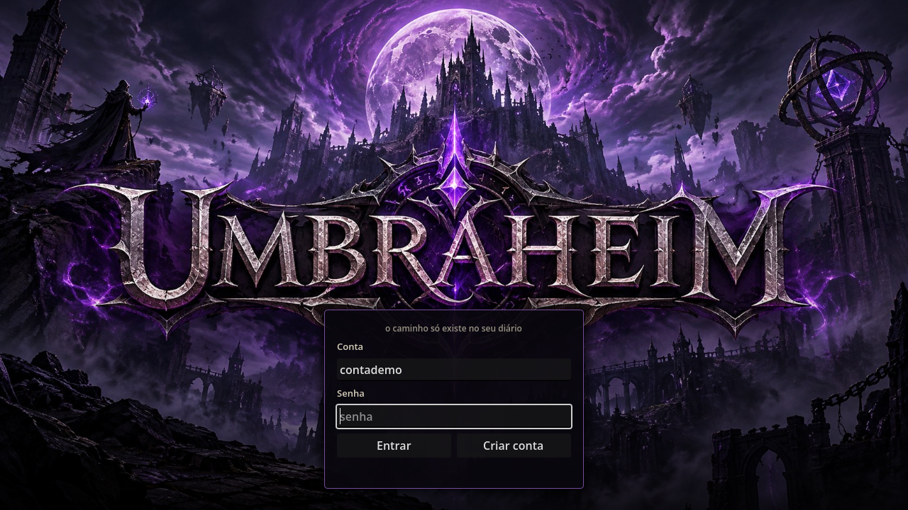
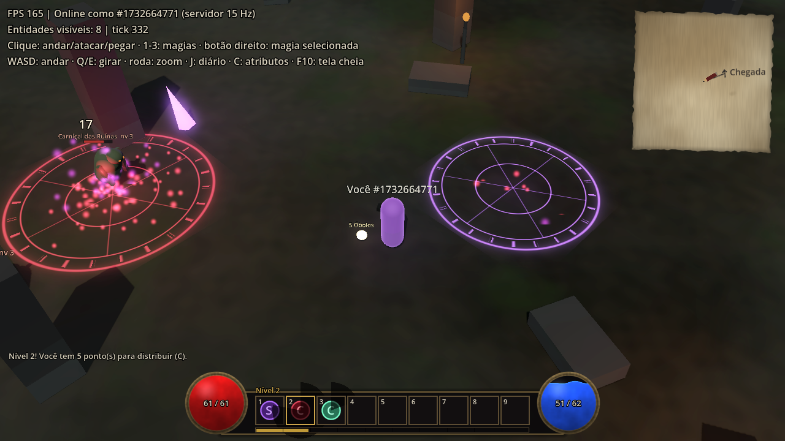

# Umbraheim



MMORPG de fantasia sombria centrado em feitiçaria, feito na Godot 4.7 e pensado para rodar no navegador.
Estado: **as seis fases do plano concluídas**. Fase 6 — eventos e endgame: eventos com horário (Fortaleza Sitiada, Arena das Ondas, Círculo que Encolhe), reset, árvore de maestria e o cerco ao castelo, com impostos da guilda dona. Da Fase 5: três classes (Feiticeiro Abissal, Cavaleiro Profano, Vidente do Véu) com evolução por missão; PvP com consequências (Ctrl+clique, autodefesa, Fora da Lei em três níveis, Herói); guildas com cargos, símbolo de pixels, chat e guerra de guildas; lista de amigos. Das fases anteriores: três regiões com portais, chefes, invasões douradas e asas; contas e tudo salvo em SQLite; chat, grupo e troca; inventário, refino e a cidade com lojas e cofre. Servidor autoritativo via WebSocket, com interesse por área e predição.

O servidor usa a extensão [godot-sqlite](https://github.com/2shady4u/godot-sqlite) (MIT), já incluída em `addons/godot-sqlite` (só Windows e Linux; o cliente Web não a carrega).



## Requisitos

- Godot **4.7.2** (versão padrão, não a .NET). Os scripts procuram o executável em
  `Downloads\Godot_v4.7.2-stable_win64.exe\`. Para usar outro caminho, defina a variável `GODOT_BIN`.
- Para gerar as builds Web e de servidor: os **export templates 4.7.2**
  (no editor: *Editor → Gerenciar Modelos de Exportação → Baixar e instalar*).
- Python 3, só para servir a build Web localmente.

## Executar

Todos os comandos rodam no PowerShell, a partir da raiz do projeto.

| O quê | Comando |
|---|---|
| Abrir no editor | abrir a Godot e importar `project.godot` |
| Servidor e 2 clientes (desktop) | `.\tools\run_local.ps1` (`-Clients 3`, `-Quick` entra direto, `-Gm` libera comandos de GM) |
| Só o servidor (headless) | `godot --headless --path . -- --server` (banco em `user://umbraheim.db`; `--db=:memory:` para um banco descartável) |
| Cliente entrando direto | `godot --path . -- --login=conta:senha:Personagem` (cria a conta e o personagem se não existirem) |
| Cliente apontando para outro servidor | `godot --path . -- --url=ws://IP:7777` |
| Bot de teste de rede | `godot --headless --path . -- --bot --bot-seconds=20` |
| Testes automatizados | `.\tools\run_tests.ps1` |
| Build Web e tamanho do download | `.\tools\build_web.ps1` |
| Servir a build Web | `python tools/serve_web.py` e abrir http://localhost:8060 |

Na Web o cliente conecta em `ws://<host da página>:7777`. Para outro endereço, use `?server=ws://host:porta` na URL.
Em produção (HTTPS), o cliente conecta em `wss://<host>/ws` através do proxy reverso. Instalação no servidor: [docs/DEPLOY.md](docs/DEPLOY.md).

## Controles

| Ação | Controle |
|---|---|
| Andar | clique no chão (segurar segue o mouse) ou WASD |
| Ataque básico contínuo | clique no monstro |
| Pegar item | clique no item no chão |
| Magias | teclas 1–3 (no monstro sob o mouse ou no chão); botão direito repete a última |
| Diário (mapa a lápis) | J abre em tela cheia (com o painel Viajar: teletransporte para regiões já desenhadas); M oculta/mostra o minimapa (ou o × no canto da folha) |
| Atributos e pontos | C (Shift+clique no + soma 5); no nível máximo, botão Renascer (só no Refúgio) |
| Castelo | Arauto do Cerco, no Refúgio: inscrever a guilda (mestre), entrar no cerco, imposto e tesouro (mestre dono) |
| Maestria | K: três árvores (Ataque, Defesa, Utilidade); clique num nó para pôr 1 ponto |
| Inventário | I ou V: clique pega/solta, botão direito equipa, soltar fora joga no chão |
| Refinar com joia | clique na joia e depois no item |
| Usar poção, pergaminho ou grimório | botão direito no item; Z = tônico de vida, X = essência de mana |
| Lojas (ferreiro, alquimista) | clique no NPC; clique compra, Shift+clique compra 10, botão direito na mochila vende |
| Cofre | clique no Guardião do Cofre; botão direito guarda/retira, clique pega e solta |
| Forja do Vórtice | clique no artefato; botão direito no item da mochila coloca na mesa. Asas: equipamento +7 ou mais + 2 Gemas do Vórtice + 1 Pedra da Gênese + 1 Fragmento de Alma |
| Fechar janela de NPC | Esc, Fechar ou afastar-se |
| Chat | Enter abre; texto = geral, `/g` grupo, `/gu` guilda, `/s Nome` sussurro, `/r` responder, `/ajuda` |
| Eventos | contador no canto direito; quando os portões abrirem, use o ingresso com o botão direito (Selo da Fortaleza, Emblema da Arena, Marca do Círculo, todos feitos na Forja do Vórtice) |
| Classes | escolha ao criar o personagem; evolução a partir do nível 20 com o Ancião Varek (atrás do braseiro do Refúgio); tecla 5 = magia da evolução |
| Guilda e amigos | G abre a guilda (fundar com nome e símbolo de pixels, membros, cargos, convite, guerra); F abre os amigos |
| Outro jogador | clique nele: sussurrar, convidar para o grupo ou para a guilda, adicionar amigo ou propor troca. **Ctrl+clique ataca** (PvP, fora das zonas seguras; Ctrl+tecla usa a magia nele) |
| Troca | botão direito na mochila oferece; Pronto, depois Confirmar (os dois) |
| Câmera | Q/E giram, roda do mouse dá zoom |
| Tela cheia | F10 |

## Pastas

```
client/   cenas e scripts do cliente (câmera, entidades, HUD, debug)
server/   lógica autoritativa
shared/   configuração, protocolo e rede usados pelos dois lados
data/     configuração e balanceamento (JSON)
assets/   shaders (e futuramente modelos, sons e fontes)
docs/     especificação, arquitetura, decisões, guia de arte e relatórios de fase
tests/    testes automatizados (executor próprio, sem dependências)
tools/    scripts de build, execução e servidor web local
```
