# Relatórios de fase

## Ajustes pedidos depois dos testes (2026-11-14, em andamento)
- **Inimigos mais fortes:** todos os monstros (inclusive chefes, dourados e os dos eventos) com 2× vida e 1,5× dano. Os portões de evento ficaram como estavam.
  - A XP por monstro não mudou, então subir de nível fica mais lento; ajustar `progression.monster_xp` se for preciso.
- **Mais inimigos:** os grupos das Ruínas, do Bosque e da Geleira dobraram e ficaram um pouco mais espalhados (raio ×1,3). Total: Ruínas 10 → 19 monstros, Bosque e Geleira 14 → 27. Os chefes seguem únicos.
- **Lobo corrigido:** andava e atacava de costas. O giro do modelo (`yaw_deg` em `models.json`) passou de 90° para -90°, igual ao do dragão do mesmo pacote. Conferido na vitrine.
- **Personagens realistas:** esperando os pacotes Universal Base Characters e Modular Character Outfits – Fantasy (Quaternius, CC0), que precisam ser baixados à mão.
- **Menus e ambientação:** dois especialistas (UI/UX de jogos e direção de arte/ambientação) fizeram as propostas `docs/design/PROPOSTA_UI.md` e `PROPOSTA_AMBIENTACAO.md`, aprovadas em 2026-11-14 (com a OFL para fontes).

### Redesenho, primeiras partes: interface A+B e ambientação 1+2 (entregue em 2026-11-14)
Antes: `docs/design/img/atual_*.png` e `img/ambientacao/diag_*.png`. Depois: `docs/design/img/depois/`.
- **Interface A, tema único:** paleta, fontes e tamanhos em `ui.json -> theme`, lidos por `UiPalette` (`client/ui/theme/`).
  - `UiThemeBuilder.install()` (chamado no `main.gd` antes de criar o cliente) mescla o tema no tema padrão do Godot. Assim ele vale também para o que está em CanvasLayer, onde o tema da janela raiz não chega.
  - Fontes (Google Fonts, OFL, `tools/fetch_fonts.py`): Cinzel nos títulos, Alegreya Sans no texto, IM Fell English para textos de história.
  - As telas usam variações: `WindowPanel`, `WellPanel`, `PrimaryButton`, `DangerButton`, `GhostButton`, `TitleLabel`, `HeaderLabel`, `HintLabel`, `LoreLabel` e `ValueLabel`.
  - As cores fixas dos painéis viraram cores da paleta; 12 janelas trocaram o StyleBoxFlat próprio por `WindowPanel`.
- **Interface B, molduras:** as texturas 9-slice são geradas no código (sem arquivos):
  - placa de ferro com cantos de losango dourado;
  - botões chanfrados (âmbar no principal, sangue no perigoso);
  - fundo rebaixado, separador com losango no meio, caixas de marcar em losango.
- **Ambientação 1, dados:** `data/config/ambience.json` define o clima por região (sol, luz de preenchimento, ambiente, névoa, céu, glow, contraste e saturação, tonemap, vinheta, névoa falsa, cor do chão).
  - Perfis de qualidade: médio na Web, alto no desktop.
  - `AmbienceDirector` (`client/world/ambience_director.gd`) aplica tudo quando a região carrega.
- **Ambientação 2, luz por região:**
  - Ruínas: lua baixa e fria, sombras longas.
  - Bosque: verde apagado, mais claro que no primeiro ajuste.
  - Geleira: azul e sem estourar o branco.
  - As regiões de evento e o castelo também têm clima.
- **Licença das fontes:** o `OFL.txt` de cada fonte vai junto na build (`include_filter` dos perfis de cliente; `update_export_filter.py` não o exclui). O `CREDITS.md` ganhou a seção OFL.
- **Conferido:**
  - 77 testes ok;
  - cliente desktop com captura de tela de entrada, inventário, atributos, diário e as três regiões abertas;
  - build Web (`index.pck` 20,5 MB): entrada, criação de personagem e mundo, sem erros no console.
- **Não verificado:**
  - o clima das regiões de evento e do castelo (são instâncias que o `goto` não alcança); os valores vêm da proposta;
  - na seleção de personagem da Web, em janela estreita, o painel passa da borda. Já era assim antes; fica para a parte E (entrada e seleção).
- Aceito pelo usuário em 2026-11-14.

### Redesenho: interface C+D e ambientação 3 (entregue e aceito em 2026-11-14)
Imagens em `docs/design/img/depois/`: `hud.png`, `janelas.png`, `maestria.png`, `bosque_particulas.png` e `geleira_particulas.png`.
- **Interface C, componentes:**
  - `UiFx` (`client/ui/theme/ui_fx.gd`) vale para toda janela solta com `WindowPanel`, sem mexer em cada uma:
    - abre com animação (140 ms, escala e opacidade);
    - toca som ao abrir e fechar (`ui_open` e `ui_close` em `audio.json`);
    - arrasta pela faixa do título, sem sair da tela.
  - Os botões "×" viram o fechar em losango (variação `CloseButton`).
  - `DiamondButton` (`client/ui/theme/diamond_button.gd`): botão e ícone em losango, com glifo, cor de destaque, selo embaixo e estado apagado.
  - O inventário passou a usar a moldura do tema e também arrasta. A loja, o cofre e a troca se posicionam a partir dele ao abrir.
- **Interface D, HUD:**
  - **Depuração:** o texto (FPS, conexão, teclas) saiu da tela e fica atrás do **F3** (`--debug-hud` começa visível).
  - **Canto superior esquerdo:** região ou zona em Cinzel, com subtítulo.
  - **Orbes:** anel de metal com quatro cravos.
  - **Poções:** losangos colados aos orbes, com a tecla e a quantidade.
  - **Vagas de magia:** cantos chanfrados e tecla num losango; a selecionada brilha na cor da magia, e as vazias ficam apagadas.
  - **Nível e XP:** o nível fica num losango no meio da placa; a barra de XP tem 8 px, 10 segmentos e brilho na ponta.
  - **Botões de sistema:** seis losangos à direita da barra (inventário, atributos, diário, maestria, guilda, amigos). A tecla aparece no tooltip, e a lista fica em `ui.json -> theme.system_buttons`.
  - **Eventos:** placa recolhível com losango de estado:
    - âmbar: abre em menos de 5 min (`events_soon_s`);
    - verde: portões abertos;
    - dourado: em andamento.
  - **Alvo e atributos:** o alvo usa o fundo rebaixado do tema; a janela de atributos usa a moldura e tem o fechar em losango.
- **Ambientação 3, partículas:**
  - `ambience.json -> particle_types`: cinza flutuando, cinza caindo, neve com vento, cintila de gelo, vaga-lume, fiapo espectral, brasa, poeira e mote do vazio.
  - Cada região lista as suas: Ruínas (cinza e vaga-lumes violeta), Bosque (cinza caindo e fiapos verdes), Geleira (neve e cintilas), Fortaleza e Castelo (brasas), Arena (poeira), Círculo (motes).
  - Um emissor por tipo segue o personagem (`AmbienceDirector.follow`). A quantidade é multiplicada pelo perfil: 0,4, 0,7 ou 1,0.
- **Conferido:**
  - 77 testes ok;
  - capturas no desktop: HUD, atributos com maestria, inventário com atributos, partículas nas três regiões abertas;
  - build Web (`index.pck` 20,5 MB): entrada no mundo, botão de sistema abrindo o inventário, janela arrastada pelo título; console sem erros.
- **Não verificado:**
  - partículas das regiões de evento e do castelo (instâncias);
  - FPS na Web com as partículas (o painel do navegador não mede bem);
  - na janela estreita do navegador (cerca de 640 px), a placa de eventos e os botões de sistema ficam apertados. Em 1280×720 cabem.
- **Ficou para depois** (está na proposta):
  - tooltip rico e retratos do grupo (parte F/G);
  - chat e toasts (H);
  - brasas e fumaça em pontos fixos (braseiros do Refúgio): pedem as posições na cena, vão junto da parte 4 (decoração).
- **Próximas partes:** interface E (entrada e seleção), F (inventário e janelas de NPC), G–I; ambientação 6 (cena de entrada), 5 (materiais) e 4 (decoração).

### Redesenho: interface E+F e ambientação 6 (entregue e aceito em 2026-11-16)
Imagens em `docs/design/img/depois/`: `login.png`, `selecao.png`, `selecao_criar.png`, `inventario.png`, `loja.png`, `forja.png` e `cofre.png`.
- **Ambientação 6, cena de entrada** (`LoginScene`, `client/ui/login_scene.gd`; dados em `data/config/login_scene.json`):
  - a arte do nome com zoom lento (Ken Burns) e paralaxe pelo mouse;
  - brilho violeta pulsando na lua e relâmpagos raros (no máximo 3 por minuto);
  - duas camadas de fumaça (`assets/shaders/ui_smoke.gdshader`), brasas subindo (10% violeta), cinza caindo e vinheta.
  - Na seleção, a arte escurece e a fumaça e as brasas tomam a cor da classe escolhida.
- **Interface E, entrada e seleção** (`client/ui/login_screen.gd`, reescrita com a mesma API):
  - **Entrada:** painel de 360 px com subtítulo, rótulos em Cinzel, "Entrar" em destaque, "Criar conta" e rodapé com a versão do protocolo.
  - **Seleção, tela larga (a partir de 960 px):**
    - à esquerda: classe, descrição e atributos iniciais;
    - no centro: o modelo 3D girando sobre um círculo rúnico, com contraluz na cor da classe (`ClassPreview`, `ui.json -> theme.class_preview`);
    - à direita: cartões dos personagens e "+ Novo personagem";
    - embaixo: o nome ou, no modo de criação, ‹ classe › com o campo de nome.
  - **Seleção, tela estreita:** os cartões no topo e o modelo no vão até o nome; o painel da classe some.
  - **Não feitos:** "Sair" e "Apagar personagem". O servidor ainda não tem mensagem de logout nem de apagar personagem.
- **Interface F, inventário e janelas de NPC** (`UiDraw`, `client/ui/theme/ui_draw.gd`, desenha grade em poço, contorno tracejado, moeda, círculo rúnico e silhuetas dos slots):
  - **Inventário:**
    - título com "?" (as instruções viram tooltip) e fechar em losango;
    - silhueta do personagem atrás do boneco e silhueta de cada slot vazio;
    - grade em poço; prévia de onde o item cai, tracejada em verde ou vermelho;
    - sombra no item segurado; fundo na cor da raridade; brilho pulsante a partir de +7;
    - rodapé com moeda e valor;
    - tooltip com o nome em Cinzel, separadores e cores da paleta.
  - **Loja:** grade em poço e preço no pé de cada item com a moeda (vermelho se não der para pagar), saudação em itálico e fechar em losango.
    - Não há abas de categoria: as lojas em `shops.json` não têm categorias.
  - **Forja do Vórtice:** círculo rúnico atrás das vagas (vermelho sem receita, âmbar com receita) e a chance em Cinzel no centro; "Combinar" em destaque.
  - **Cofre:** grade em poço, prévia tracejada e fechar em losango.
  - **Troca:** duas colunas espelhadas (você | o outro), selo "CONFIRMADO" em cor espectral sobre quem já aceitou e o botão "Confirmar" apagado até os dois travarem.
- **Conferido:**
  - 77 testes ok;
  - capturas no desktop: entrada, seleção, modo de criação, inventário, loja, forja e cofre;
  - build Web (`index.pck` 20,5 MB): criar conta, criar personagem, entrar no mundo e abrir o inventário; console sem erros.
- **Não verificado:**
  - a troca na tela: precisa de dois jogadores (o script carrega sem erro no cliente);
  - o círculo da forja com receita reconhecida, com a chance no centro;
  - a loja numa janela estreita.
- **Nota:** o cliente ficou mais rápido na tela de entrada, e as capturas com `--quick-login` precisam de `--screenshot-frames=700` ou mais, senão a captura sai antes de entrar no mundo.
- **Próximas partes:** interface G (outras janelas), H (chat, avisos e toasts), I (ícones e sons); ambientação 5 (materiais) e 4 (decoração, com os braseiros).

### Redesenho: interface G+H e ambientação 5 (entregue e aceito em 2026-11-16)
Imagens em `docs/design/img/depois/`: `atributos_maestria.png`, `missao.png`, `cerco.png`, `social_toasts.png`, `chat.png`, `aviso_evento.png`, `morte.png`, `castelo_antes.png`, `castelo_depois.png`, `estandarte.png`, `geleira_antes.png` e `geleira_gelo.png`.
- **Interface G, demais janelas:**
  - **Atributos:** classe em Cinzel na cor dela; cada atributo com losango, valor grande e o "+" num losango âmbar que pulsa enquanto há pontos livres; derivados em duas colunas.
  - **Maestria:** três trilhas verticais de nós em losango, ligados por um fio na cor da trilha; cada nó tem barra fina de progresso (pontos/máximo) e brilha quando aceita ponto.
    - Sem confirmação no clique (a proposta pedia): o ponto continua indo direto, como antes.
  - **Missões:** pergaminho (painel `ParchmentPanel`, papel gerado no código), texto em IM Fell English, etapas com caixinha em losango que se preenche.
  - **Social:** abas com losango, linhas alternadas e ponto de presença (verde online, vazado offline).
  - **Cerco:** placa com o castelo e o dono (símbolo num quadro de metal), imposto grande e o cronômetro em âmbar, em Cinzel.
  - **Viajar:** pergaminho preso ao diário, entradas em tinta.
  - **Convites:** título por tipo, "Recusar" à esquerda e "Aceitar" em destaque à direita, barra do prazo esvaziando.
    - Sem escurecer o fundo: o convite chega no meio da luta e não deve atrapalhar.
  - **Grupo:** barra de vida no estilo do tema (âmbar com pouca vida).
- **Interface H, chat e avisos** (`Notices`, `client/ui/notices.gd`; tempos em `ui.json -> theme.notices`):
  - **Chat:** etiqueta de canal em cada linha (`[G]`, `[Gr]`, `[Gu]`, `[S]`, `[!]`), fundo de tinta a 55% que some com as linhas (85% e moldura ao digitar) e losango do canal na linha de digitação (clique alterna geral, grupo e guilda; texto sem "/" vai para o canal escolhido).
  - **Aviso de evento:** placa no topo, título âmbar em Cinzel, separador com losango, entrada animada. Recebe os anúncios do servidor e os portões que abrem.
  - **Título de área:** Cinzel grande, sem placa, com contorno e sombra larga; desce para baixo da placa de evento quando os dois aparecem juntos.
  - **Toasts** à direita, acima da lista de eventos, somem em 4 s:
    - item novo na mochila;
    - missão nova, etapa nova ou missão concluída;
    - amigo entrou no jogo.
  - **Morte:** a tela escurece com vinheta vermelha, "VOCÊ CAIU" em Cinzel e o cronômetro de retorno.
  - Debug: `--preview-notice=event|toast|death|chat` (só para capturas).
- **Ambientação 5, materiais** (valores em `ambience.json`; `_materials_doc` explica cada campo):
  - **Chão com textura** (Ruínas, Fortaleza, Arena, Círculo, Castelo): `ground_macro.gdshader` com manchas grandes que escurecem, mancha de cor (terra, fuligem) e dessaturação por região.
    - A segunda amostra girada (anti-repetição) só vale em chão orgânico (Ruínas e, mais fraca, Fortaleza). Em calçamento regular ela entortava as pedras, por isso fica desligada.
  - **Relevo procedural** no chão de terra e neve (Bosque e Geleira): normal calculada do ruído, sem textura nova.
  - **Gelo:** `ice.gdshader` nos blocos e espinhos (veios, rachaduras, brilho interno, recorte azul).
  - **Pontinhos do muro do Castelo:** a causa era uma pedra clara grande na textura `castle_wall_slates`, que se repete a cada 2,2 m. Ela foi coberta com pedras vizinhas no próprio albedo (CC0). Se `tools/fetch_assets.py` baixar a textura de novo, o conserto se perde.
  - **Estandartes de pano** no Castelo: plano subdividido com `cloth_banner.gdshader` (balanço, dobras, faixa e losango dourados, ponta em rabo de andorinha), no lugar das caixas chapadas.
  - **Sombra de contato** sob personagens e monstros (disco macio, `ambience.json -> contact_shadow`).
  - **Contorno sutil** de personagens e monstros na cor de assinatura da região (`regions.<id>.rim`). No perfil "baixo" ele é desligado (`character_rim`).
  - Ferramenta nova: `scenes/dev/region_preview.tscn` mostra qualquer região com o clima aplicado, sem servidor (`--region=`, `--at=x,z`, `--dist=`, `--shot=`). Serve para as regiões de evento, que o `goto` não abre.
- **Conferido:**
  - 77 testes ok;
  - capturas no desktop: as janelas e avisos acima, Castelo (chão, muro, estandarte), Arena, Geleira (no jogo e na prévia), Bosque;
  - build Web (`index.pck` 20,6 MB): entrada, atributos e chat abertos, console sem erros.
- **Não verificado:**
  - os shaders novos de chão e gelo na Web dentro da Geleira e das regiões de evento (na Web só vi as Ruínas);
  - o FPS na Web com o chão novo, as sombras de contato e o contorno;
  - o contorno da região nos monstros, de perto (nas capturas eles estavam longe);
  - os toasts de verdade (item, missão, amigo): vistos só pela prévia;
  - a troca, que precisa de dois jogadores (continua pendente da parte F).
- **Próximas partes:** interface I (ícones e sons); ambientação 4 (decoração e moldura das bordas, com os braseiros). Os kits de cemitério e castelo da Kenney ajudariam na 4.

### Redesenho: interface I e ambientação 4 (entregue e aceito em 2026-11-16)
Imagens em `docs/design/img/depois/`: `icones_hud.png`, `ruinas_decor_antes_depois.png`, `bosque_decor_antes_depois.png`, `bosque_borda_antes_depois.png`, `geleira_borda_antes_depois.png`, `refugio_braseiro_antes_depois.png`, `fortaleza_tocha.png` e `ruinas_jogo_decor.png`.
- **Interface I, ícones** (`UiIcons`, `client/ui/theme/ui_icons.gd`):
  - Ícones originais desenhados no código (silhuetas preenchidas com contorno escuro, na cor da magia), sem baixar nada. O game-icons.net da proposta precisaria de download e créditos visíveis; fica como opção.
  - Magias: por tipo (dardo, explosão, raio, espada, anel, escudo, cura, espírito) e, para algumas, ícone próprio (chama, meteoro, fenda, sol). Qual ícone cada coisa usa: `ui.json -> theme.icons`.
  - Botões de sistema: mochila, busto, livro, estrela, estandarte e dois bustos (amigos). O `DiamondButton` ganhou `icon_id` (o `icon` do Button já existia).
- **Interface I, sons** (`audio.json -> ui`: evento → som; `SoundDirector.ui(evento)`):
  - Segunda rodada de candidatos Kenney (CC0), variantes mais suaves: as da primeira rodada estavam todas em `rejected.json`.
  - Clique, abrir/fechar janela (couro), confirmação, erro, pegar/largar/equipar item, moedas (quando o ouro muda), página (diário e missões), trinco (cofre).
  - Hover continua com o som antigo, agora como `ui_hover`.
  - **Para você ouvir e escolher:** os 12 arquivos novos estão em `assets/audio/sfx/ui/kenney_*.ogg`. A cena `scenes/dev/audio_preview.tscn` serve para descartar os que não gostar.
- **Ambientação 4, decoração e moldura** (`DecorLayer`, `client/world/decor_layer.gd`; dados em `ambience.json -> regions.<id>.decor`, formato em `_decor_doc`):
  - Só no cliente, sem colisão, com semente própria. Não muda a semente do `RegionScenery` nem a grade de navegação.
  - Uma `MultiMeshInstance3D` por malha de modelo; quantidade vezes `decor_mult` do perfil (baixo 0,45, médio 0,75, alto 1).
  - Dentro da área andável: mato seco, pedrinhas, entulho, cogumelos, samambaias; evita trilhas, áreas livres, zonas seguras e obstáculos.
  - Moldura: anel de árvores retorcidas, árvores mortas, pinheiros e pedras escuras entre 39,5 e 47 m (a área andável vai até 38 m).
  - Pinheiros e pedras retingidos por região (`scenery_tint`): oliva queimado no Bosque, azul gelado na Geleira.
  - **Fogos em pontos fixos** (`fires`): braseiro e forja do Refúgio, tochas do portão do Refúgio e as 10 tochas da Fortaleza (modelo `Torch_Metal` na parede), com chama, fagulhas e fumaça. Ficam nas luzes que já existiam na cena. A chama antiga do braseiro (malha chapada) foi escondida.
  - Fumaça com mistura normal (`particle_tex_mix.gdshader`); tipos novos `chama`, `fagulha` e `fumaca` em `particle_types`.
  - Castelo: só pedrinhas, mato e moldura. Arena e Círculo ficaram sem decoração (são de piso).
- **Build:**
  - `tools/update_export_filter.py` agora lê `ambience.json` (texturas das partículas e modelos da decoração). Sem isso, eles ficavam fora da build.
  - 32 texturas dos kits Quaternius estavam com a importação 2D: passaram a VRAM com mipmaps, até 512 px (normais 256).
  - `index.pck`: de 20,6 MB para 25,0 MB (os modelos novos).
- **Conferido:**
  - 77 testes ok;
  - capturas antes e depois das regiões (prévia) e no jogo (Refúgio, Ruínas, Bosque);
  - build Web: criar conta e personagem, entrar no mundo (Refúgio com o braseiro novo e os ícones), abrir a loja; console sem erros.
- **Não verificado:**
  - os sons: não dá para ouvir aqui. Volumes escolhidos pelo nível medido (-16 LUFS), sem teste de ouvido;
  - o FPS na Web com a decoração (o perfil médio desenha 75% das peças);
  - a Fortaleza, o Castelo e a Geleira na Web (só no desktop);
  - o ícone de cada magia ainda não aprendida (o cadeado cobre).
- **Próximo:** era a última parte da proposta. Pendentes de partes anteriores: a troca entre dois jogadores e o FPS na Web.

## Etapa extra — Áudio (escolha feita em 2026-11-14)
- `tools/fetch_audio.py` baixa os originais para `assets/_raw/audio/` (fora do projeto Godot), cada um com um `.json` de metadados:
  - Kenney (CC0): UI Audio, Interface Sounds, Impact Sounds e RPG Audio;
  - 8 candidatas para a música do menu: 4 do incompetech (Kevin MacLeod, CC-BY 4.0) e 4 do OpenGameArt (CC-BY 3.0/4.0);
  - Freesound (CC0 e Attribution, até 5 por busca; prévia HQ em OGG): 58 sons em 12 buscas. A busca "curse" trazia palavrões e virou "curse spell".
- `tools/process_audio.py` converte com ffmpeg:
  - OGG Vorbis 44,1 kHz; SFX em mono, música em estéreo;
  - silêncio cortado nas pontas; música a -20 LUFS;
  - SFX miram -16 LUFS com o pico limitado em cerca de -1 dBFS (os sons curtos e secos ficam abaixo de -16);
  - música com `loop=true` no `.import`.
  - O script também gera `assets/audio/candidates.json`, `assets/audio/REVIEW.md` e as linhas do manifesto.
- 88 candidatos: 22 SFX da Kenney, 58 do Freesound (36 CC0, 22 CC-BY) e 8 músicas.
- Escolha em `scenes/dev/audio_preview.tscn`: ▶ toca; marque "manter" e salve, o que grava `assets/audio/selection.json`. Depois, `python -I tools/process_audio.py --apply-selection` apaga os descartados.
- **Escolha (2026-11-14): 22 de 88 mantidos**, 66 apagados de `assets/audio/` (os originais ficam em `_raw`):
  - música do menu: *Oppressive Gloom* (Kevin MacLeod);
  - combate 4, passos 4, magia 5, monstros 4, ambiente 3 e interface 1.
  - Os descartados ficam em `assets/audio/rejected.json`: rodar o `process_audio.py` de novo não os traz de volta, só converte sons novos (por exemplo, de `downloads/`).
- **Sons ligados no jogo** (`SoundDirector`, `client/audio/sound_director.gd`; tudo em `data/config/audio.json`):
  - música do menu na tela de entrada; no mundo, ambiente em loop por região (masmorra, eco ou coral);
  - lançamento de magia por tipo (fogo em Chuva de Brasas, Círculo de Chamas Negras e Meteoro do Vazio) e impacto no tempo do efeito;
  - golpe no alvo e dano no próprio personagem; voz dos monstros ao atacar (com intervalo e sorteio) e na morte, por id ou modelo (mortos-vivos, feras, abissais, espectros, pedra); som de subida de nível e da morte do personagem;
  - passos do próprio personagem a cada 1,7 m, conforme a região (pedra, grama, gelo);
  - clique em qualquer botão da interface;
  - canais Music, Ambient, SFX e UI, com volume nos dados; sons no mundo caem com a distância até o personagem.
- Conferido: o cliente roda sem erros; na cena de teste tocaram a música, o ambiente em loop, os 29 sons e o clique; o novo teste `test_audio_references` confere arquivos e referências (77 ok); a build Web abre sem "No loader found" (`index.pck` 15,4 → 19,6 MB).
- Não verificado: ouvir os sons durante o jogo (eu não ouço áudio) e entrar no mundo pela build Web (só a tela de entrada).

## Assets no jogo (concluído e aceito em 2026-11-13)

**Plano em 3 partes:** (1) mundo: chão e muros com texturas reais, modelos de natureza no cenário procedural e objetos no Refúgio; (2) personagens e monstros com modelos e animações; (3) efeitos (partículas e shaders da biblioteca).

**Licenças:** CC0 e CC-BY, mais a Quaternius Asset License (QAL), aceita pelo usuário em 2026-11-13.

### Parte 3: efeitos — entregue
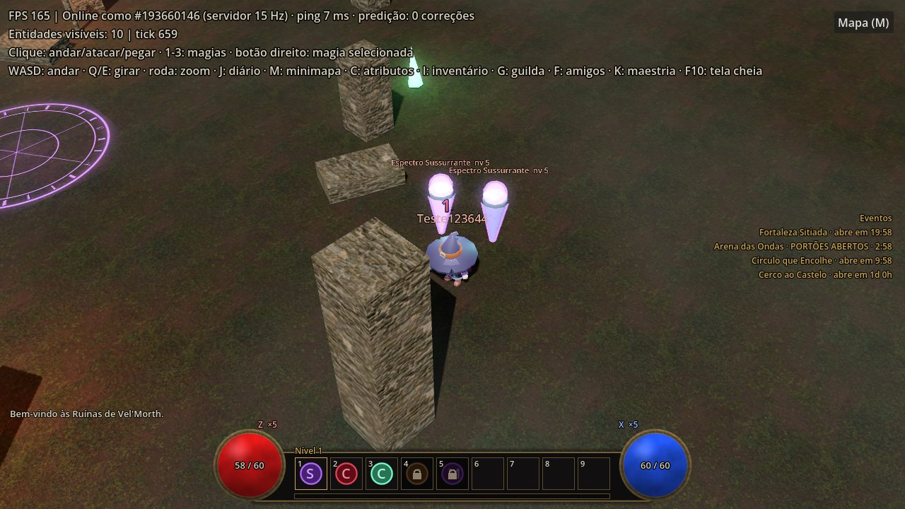

- **Partículas com forma** (pacote de partículas da Kenney, CC0): rastro dos projéteis (magia), impacto (faísca), erupção das áreas (chama), fumaça, aura de bônus e cura (estrela), subida de nível e refino (estrela) e morte (fumaça).
  - Um shader só (`assets/shaders/particle_tex.gdshader`) com a textura e um giro.
  - A forma de cada tipo, o giro e o tamanho ficam em `vfx.json -> particle_shapes`; sem textura, volta o disco macio de antes.
- **Morte com dissolução** (`assets/shaders/dissolve_world.gdshader`, adaptado do Vertical Dissolve, CC0):
  - o corpo se desfaz de cima para baixo com uma borda violeta brilhante, mantendo cor e textura;
  - com modelo animado, a dissolução começa depois da queda, na altura do corpo caído;
  - sem modelo (espectros, tronco, golem), começa na hora;
  - vale também para dourados e chefes.
- **Aura nos espectros e na Cria do Abismo** (Pulse Aura, CC0): uma casca pulsante violeta (Véu) ou azul-gelo (Espectro Gélido). A seleção com o mouse troca a aura pelo contorno e depois a devolve. Monstros escolhem com `aura` em `monsters.json`; cores em `vfx.json -> auras`.
- **Portais com profundidade** (`assets/shaders/portal_dither.gdshader`, adaptado do Dither Portals, CC0): o véu virou um túnel de camadas com dithering, escuro no centro e com a cor da região nas bordas, recortado em círculo e girando devagar.
- Na vitrine (`scenes/dev/model_lineup.tscn`): `--fx` dispara os efeitos lado a lado e `--portal` põe um portal de frente.

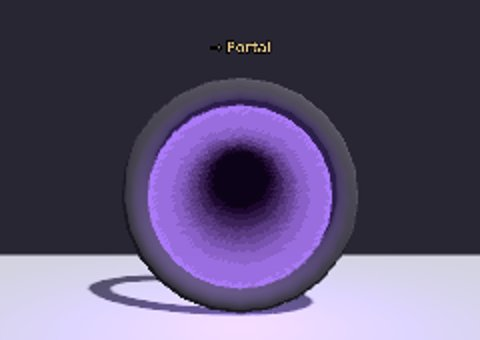
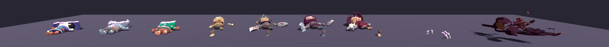

### Correção na build Web (partes 2 e 3)
- **Os modelos glb apareciam brancos no navegador.** A Godot extrai as texturas embutidas para arquivos ao lado do modelo (`Knight_knight_texture.png`), e o filtro de exportação não as via, então ficavam fora da build. Agora `tools/update_export_filter.py` inclui essas texturas e também as das partículas, que são citadas por nome em `vfx.json`. Conferido no navegador: o Cavaleiro aparece com a armadura texturizada e a espada na mão.

### Medições (parte 3)
| Item | Parte 2 | Parte 3 |
|---|---|---|
| `index.pck` | 14,5 MB | **15,4 MB** (texturas dos modelos que faltavam e partículas) |
| Build Web total | 52,9 MB | **53,8 MB** |
| FPS desktop nas Ruínas, lutando contra espectros com aura | — | 165 (limite do monitor) |
| Testes | 76 ok | 76 ok |

### Não verificado (parte 3)
- O FPS na Web com a janela visível. O painel do navegador estava oculto e marcava 1 FPS por economia de energia.
- Os efeitos de magia dentro do jogo na Web (no navegador, só o Refúgio).

### Parte 2: personagens e monstros — entregue
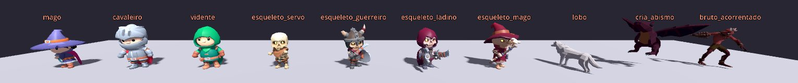

- **As três classes com modelo e animação** (KayKit Adventurers, CC0): Feiticeiro Abissal = mago de chapéu e capa, Cavaleiro Profano = cavaleiro de armadura, Vidente do Véu = encapuzado.
  - Animações: parado, andar e correr (pela velocidade), ataque corpo a corpo, gesto de magia em todo feitiço que não é corpo a corpo, reação ao golpe e morte.
  - **As armas do equipamento vão para as mãos do modelo:** cajado, espada, escudo e grimório da KayKit, com o brilho do refino e o contorno da raridade. Peças de armadura não ganham forma, porque o modelo já veste a classe; a aura de +11 continua. As asas continuam.
- **Monstros com modelo** (só os que têm um bom par; o resto mantém as formas atuais):

  | Modelo | Pacote (licença) | Monstros |
  |---|---|---|
  | esqueleto servo | KayKit Skeletons (CC0) | Carniçal das Ruínas |
  | esqueleto guerreiro (lâmina e escudo) | KayKit Skeletons (CC0) | Sentinela de Cinzas, Guardião do Trono, Abominação de Vel'Morth, Campeão da Arena |
  | esqueleto ladino (machado e lâmina) | KayKit Skeletons (CC0) | Guarda do Círculo |
  | esqueleto mago (cajado) | KayKit Skeletons (CC0) | Guardião Profanado |
  | lobo | Quaternius Animal Pack 2 (CC0) | Lobo de Cinza, Mãe-Loba Cinzenta |
  | dragãozinho, tingido de violeta | Quaternius Animated Monsters (CC0) | Cria do Abismo |
  | imp acorrentado, com as animações da UAL | Quaternius Dungeon Monsters (QAL) | Bruto Acorrentado |

  Sem modelo por enquanto: Espectros, Tronco Podre e Golem de Gelo (e o Colosso, que usa o golem). Chefes e dourados continuam funcionando com os modelos (escala, nome dourado, luz, peças douradas).
- **Tudo em dados** (`data/config/models.json`): arquivo, altura ou escala, frente, tom, malhas mantidas, clipes de cada estado, armas e ossos das mãos. Monstros escolhem o modelo com `model` em `monsters.json`; as classes, em `models.json -> classes`.
- **Animações compartilhadas:** os seis modelos KayKit usam os clipes de um só arquivo (`Skeleton_Minion.glb`), copiados uma vez por modelo e apontados para o esqueleto dele. Os outros arquivos são importados sem animações. O imp usa a UAL1, que tem os mesmos nomes de ossos.
- **Só no cliente:** o servidor, a colisão e a rede não mudaram. As formas simples ficam escondidas por baixo e voltam se um modelo faltar.
- Vitrine para conferir modelos e estados: `scenes/dev/model_lineup.tscn` (`--state=walk|attack|cast|hit|death`, `--only=<id>`, `--golden`, `--die`).

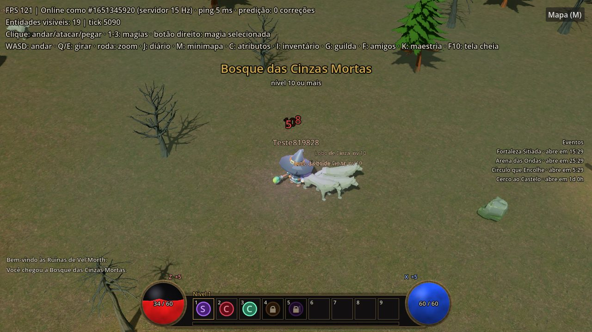

### Medições (parte 2)
| Item | Parte 1 | Parte 2 |
|---|---|---|
| `index.pck` | 9,9 MB | **14,5 MB** (modelos e animações: cerca de 4,6 MB) |
| Build Web total | 48,3 MB | **52,9 MB** |
| FPS desktop no Bosque, com 5 lobos animados | 107–120 | 121 |
| Testes | 76 ok | 76 ok |

### Verificado (parte 2)
- A vitrine com os dez modelos parados, andando, atacando, dourados, com contorno e morrendo, sem erros.
- O cliente desktop no Refúgio (Feiticeiro com cajado), nas Ruínas e no Bosque (lobos atacando), sem erros.

### Não verificado (parte 2)
- A build Web foi aberta na parte 3, que achou e corrigiu os modelos brancos (ver "Correção na build Web"). O Cavaleiro foi visto no jogo, na Web.
- O Vidente dentro do jogo (só na vitrine), as regiões de evento (esqueletos, cria, bruto) e a morte de monstros dentro do jogo (a dissolução só foi vista na vitrine).

### Parte 1: mundo — entregue
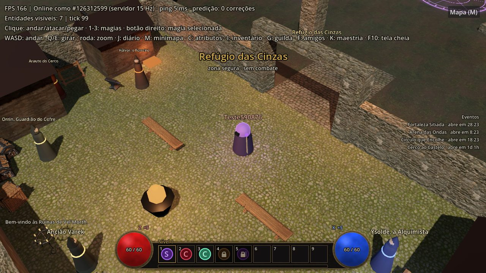

- **12 materiais** em `client/world/materials/` (cor + normal, de Poly Haven e ambientCG, todos CC0). O chão de cada região tem o seu: lama com folhas (Ruínas), terra seca do bosque, piso de mosteiro (Fortaleza), lajes (Arena), ladrilhos (Círculo), calçamento (Castelo). Muros, ruínas e casas usam pedra e madeira em projeção triplanar, sem esticar nas caixas de tamanhos diferentes.
- **Cenário procedural com modelos** (Quaternius Stylized Nature, CC0): árvores mortas, pinheiros e pedras no lugar dos cilindros e caixas. Na Geleira, o gelo continua como estava.
  - O modelo de cada ponto sai da posição, sem tocar no sorteio. Por isso o mapa, a colisão e a grade de navegação ficam iguais.
  - As formas antigas ficam escondidas e continuam sendo a colisão.
  - O servidor (headless) não carrega modelo nenhum.
- **Refúgio mobiliado** (Quaternius Fantasy Props, CC0), com 20 objetos só de decoração:
  - bigorna, armário e baús perto do ferreiro e do cofre;
  - caldeirão, poções e prateleira na alquimista;
  - barris, caixote e suporte de armas;
  - bancos, candelabros, estandartes e lanternas.
  
  As caixas que davam colisão aos móveis antigos continuam lá, invisíveis.
- **Build Web só com o que é usado:**
  - `tools/update_export_filter.py` descobre os arquivos de `assets/` que as cenas, materiais e scripts usam, mais as dependências dos glTF, e exclui o resto nos três perfis de exportação;
  - rode de novo sempre que o jogo passar a usar um asset novo;
  - `assets/assets_manifest.csv` deixou de ser importado como tradução.
- **Texturas para a Web:** VRAM (S3TC), mipmaps, cor em até 512 px e normal em até 256 px, sem mapas de rugosidade.

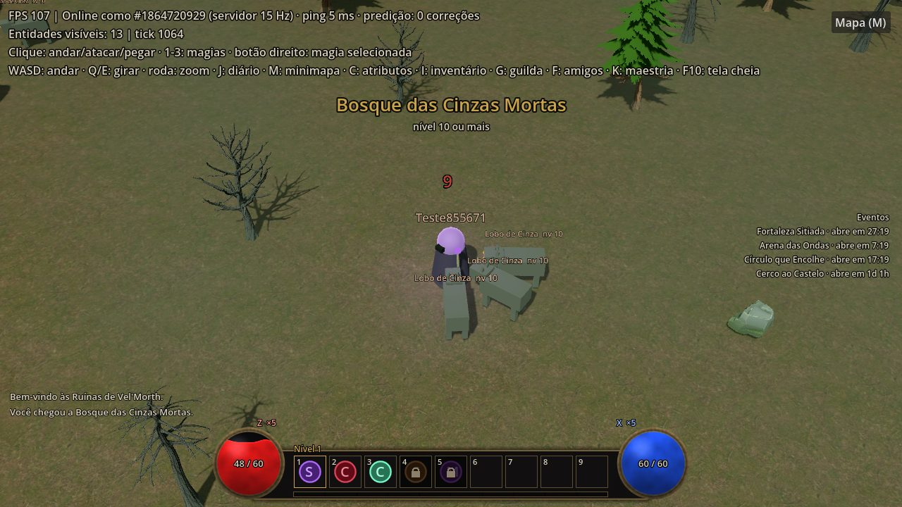
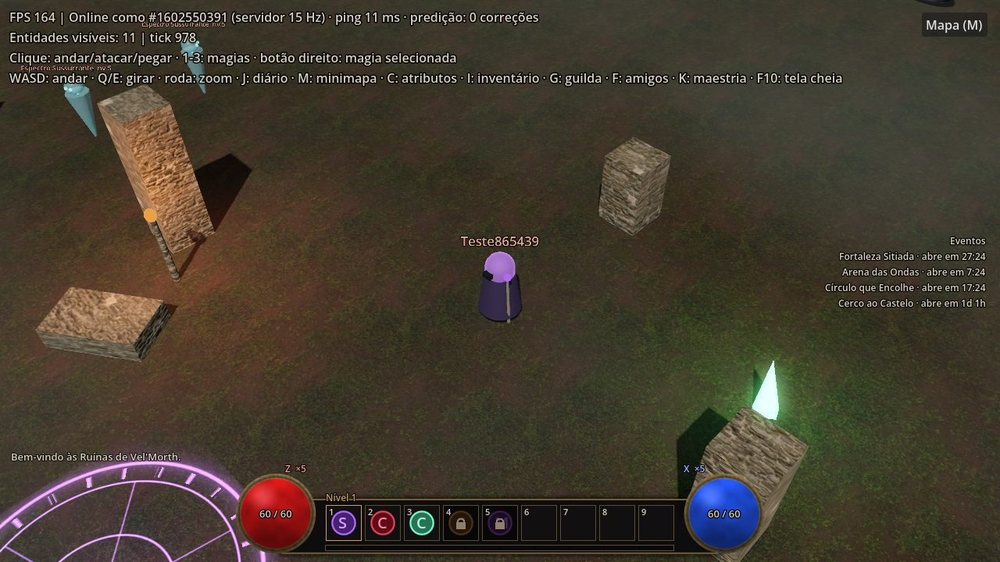

### Medições
| Item | Antes | Depois |
|---|---|---|
| `index.pck` | 2,0 MB | **9,9 MB** (modelos 2,7 MB, texturas 7 MB) |
| Build Web total | 40,4 MB | **48,3 MB** (wasm 37,7 MB) |
| FPS desktop (RTX 4050, 1280×720) | 165 | Refúgio 158–166, Ruínas 164, Bosque 107–120 |
| Testes | 76 ok | 76 ok |

### Verificado
- Cliente desktop no Refúgio, nas Ruínas e no Bosque, sem erros de script.
- Build Web no navegador embutido: login, criação de personagem e Refúgio com texturas e objetos, sem erros no console. O FPS não pôde ser medido porque o painel estava oculto (o navegador reduz a taxa de quadros).

### Não verificado
- As regiões de evento (Fortaleza, Arena, Círculo, Castelo). Os materiais delas trocaram do mesmo jeito, mas não foram capturados.
- O FPS na Web com a janela visível, principalmente no Bosque (70 árvores com cerca de 6 mil triângulos cada).

## Fase 6 — Eventos e endgame (concluída)

**Plano em 4 partes:** (1) eventos com horário e o primeiro deles, a Fortaleza Sitiada; (2) Arena das Ondas (sobrevivência em ondas com ranking) e Círculo que Encolhe (battle royale); (3) reset e árvore de maestria; (4) cerco ao castelo, com impostos da guilda dona.

### Parte 4: cerco ao castelo e impostos — entregue
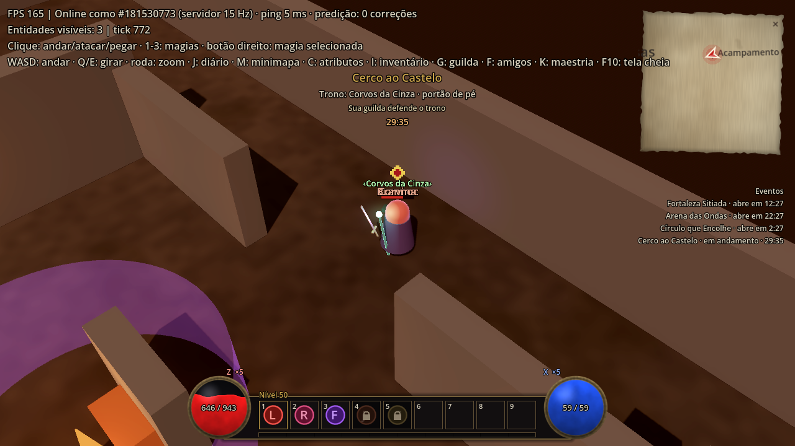

- **Castelo das Brasas** (`data/castle.json`): uma guilda dona, o imposto que ela cobra nas lojas, o tesouro e as guildas inscritas. Fica salvo no banco a cada mudança.
- **Arauto do Cerco**, um NPC novo no Refúgio, perto do Cofre. A janela mostra:
  - o dono, com o símbolo, e o imposto atual;
  - o próximo cerco ("1d 5h", "PORTÕES ABERTOS", "em andamento") e as guildas inscritas;
  - **para o mestre** de uma guilda: inscrever-se (50 mil Óbolos; fecha quando os portões abrem). A dona defende sem se inscrever;
  - **para membros** de uma guilda inscrita ou dona: "Entrar no cerco", com os portões abertos ou durante o cerco (reforços);
  - **para o mestre dono:** o imposto (0 a 20%) e o saque do tesouro.
- **Cerco** semanal (sábado, 20:00 UTC, nos dados), com 30 min de luta e 10 min de portões abertos antes:
  - a dona nasce na **sala dos defensores** atrás do trono, e as atacantes no **acampamento**; as duas áreas são seguras;
  - **PvP por guilda:** todos contra todos, menos a própria guilda, sem infâmia;
  - o **portão da muralha** cai para os atacantes; a dona não fere o próprio portão;
  - **tomar o trono:** ficar com a sua guilda sozinha a até 3,5 m dele por 20 s. Disputa, ninguém ou a dona sozinha zeram a contagem. O trono pode mudar de mãos várias vezes, e a área aparece como um anel no chão;
  - o painel mostra quem tem o trono, o portão de pé ou derrubado e "Tomando o trono: guilda x/20 s";
  - **quem morre volta ao próprio lado**, sem sair do cerco; se o trono mudou de dono, o lado muda junto;
  - sem dona, seis Guardiões do Trono protegem o salão e somem quando alguém toma o trono;
  - **no fim**, quem estiver com o trono fica com o castelo (aviso a todos). Os membros dessa guilda que estão lá dentro ganham 3.000 × nível de XP e três joias. Uma dona nova começa com 5% de imposto e o tesouro zerado.
- **Impostos:** toda compra nas lojas paga o imposto do castelo, arredondado para cima. A loja mostra o preço já com imposto e "inclui X% de imposto do castelo (guilda)". O imposto vai para o tesouro, que o mestre dono saca no Arauto.
- Se a guilda dona é desfeita, o castelo fica sem dona.
- **Banco:** migração para a versão 6 (tabela `castles`). **Protocolo v18.**

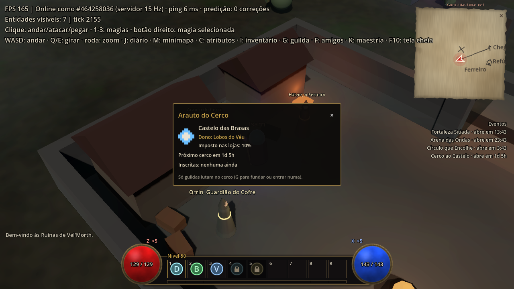

**Verificado:**
- **Testes:** 76 passam. Os novos cobrem:
  - a regra de tomar o trono (começa, continua, e zera com disputa, com a dona sozinha ou sem ninguém);
  - o imposto arredondado para cima;
  - o imposto padrão dentro do máximo;
  - a região: pontos andáveis, o portão isolando o trono do acampamento, a sala dos defensores ligada ao trono, só acampamento e sala seguros, PvP por guilda;
  - o castelo salvo e voltando do banco.
- **Dois bots** (Corvos dona pelo GM, Lobos atacante):
  - os Corvos não precisam se inscrever, e os Lobos são recusados ao entrar antes de se inscrever;
  - a inscrição cobra 50 mil Óbolos;
  - cada lado nasce no seu lugar (sala dos defensores em -31,5 e acampamento em 29);
  - o portão é derrubado (o GM deixou 5% da vida);
  - os Lobos tomam o trono com a contagem até 20 s;
  - no fim, o castelo vai para os Lobos, com 5% de imposto e o prêmio;
  - o novo mestre põe o imposto em 10%; os Corvos compram um tônico por 14 Óbolos (2 de imposto); o mestre saca os 2 Óbolos do tesouro.
- **Cliente gráfico:** convidado aos Corvos por um bot, entrou pelo Arauto durante o cerco e nasceu na sala dos defensores, com o painel e o anel do trono. A janela do Arauto mostra o dono, o imposto e o próximo cerco.
- **Regressão:** guildas, PvP, Fortaleza e fim de jogo passam como antes.
- **Web:** a build tem 38,83 MB.

**Ainda não verificado:**
- um cerco com muitos jogadores e várias guildas;
- os Guardiões do Trono em combate, num cerco sem dona;
- o cerco pelo relógio de verdade (sábado);
- os botões do Arauto clicados com o mouse (o bot manda as ações direto);
- a Web no navegador.

**Correção de processo:** dois erros de tipo, um no texto dos brilhos e outro na janela do Arauto, só apareciam no cliente gráfico. Agora rodo o cliente depois de mexer na interface: `godot -- --screenshot=... --screenshot-frames=60` compila tudo em alguns segundos.

**Debug:** GM `castleowner` (a sua guilda fica com o castelo; `castleowner none` tira), `event cerco open | start | skip | end` (`skip`: o portão fica com 5%); bots `--bot-siege=a:Outro` / `b:Outro`, `--bot-siege-invite=Nome`; cliente `--castle-enter=segundos`.

### Parte 3: reset e árvore de maestria — entregue
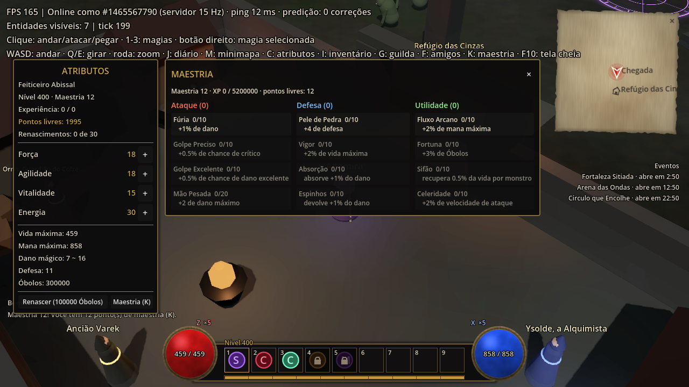

- **Reset (renascimento)**, configurável no servidor (`data/reset.json`: ligar ou desligar, nível exigido, custo, pontos, máximo de resets):
  - exige o nível 400 (o máximo), estar no Refúgio e pagar 100 mil Óbolos + 100 mil por reset já feito;
  - o personagem volta ao **nível 1** com os atributos iniciais da classe e ganha **450 pontos por reset feito**, que acumulam (o 3º reset dá 1.350);
  - ficam itens, magias, evolução, missões e maestria; até 30 resets;
  - aviso a todos e brilho de renascimento;
  - na janela de atributos (C): "Renascimentos: N de 30" e o botão "Renascer (custo)", que pede um segundo clique para confirmar e fica cinza antes do nível exigido;
  - a lista de personagens mostra "renascido ×N".
- **Maestria** (`data/mastery.json`):
  - no nível máximo, a XP passa a encher **níveis de maestria** (400 mil × nível, até 200), e cada um dá 1 ponto;
  - **três árvores** com quatro nós cada; cada nó exige 5 pontos no anterior:

    | Árvore | Nós |
    |---|---|
    | Ataque | Fúria (dano %), Golpe Preciso (crítico), Golpe Excelente (dano excelente), Mão Pesada (dano máximo) |
    | Defesa | Pele de Pedra (defesa), Vigor (vida %), Absorção (dano absorvido), Espinhos (dano devolvido) |
    | Utilidade | Fluxo Arcano (mana %), Fortuna (Óbolos %), Sifão (vida por monstro morto), Celeridade (velocidade de ataque) |

  - os bônus somam como os do equipamento (valem também no Círculo, porque são do personagem);
  - **janela de maestria (K)** ou o botão na janela de atributos: as três colunas com pontos, máximo e bônus de cada nó. Os nós ainda trancados ficam cinza, e a dica mostra o pré-requisito;
  - a janela de atributos mostra "Nível 400 · Maestria N".
- **Banco:** migração para a versão 5 (colunas `resets`, `master_level`, `master_xp`, `master_points`, `mastery`). **Protocolo v17** (o estado do jogador ganhou renascimentos e maestria).
- **Correções:**
  - a XP de maestria podia ser dada antes do nível máximo pelo GM; agora a regra fica na própria função;
  - um erro de tipo no texto dos brilhos impedia o cliente gráfico de compilar. Os testes e os bots não carregam esse arquivo; a captura de tela pegou.

**Verificado:**
- **Testes:** 75 passam. Os novos cobrem:
  - os nós: atributo aplicado, texto e pré-requisitos possíveis;
  - pontos livres, pré-requisito, máximo e nó desconhecido;
  - a soma dos bônus e a maestria nos atributos (+20 de defesa, +10% de vida);
  - o custo do reset;
  - o reset não exigir mais que o nível máximo;
  - reset e maestria salvos e voltando do banco, e na lista de personagens.
- **Bot:**
  - no nível 399, o reset é recusado e a XP de maestria não conta;
  - no 400, 12 níveis de maestria;
  - Golpe Preciso é recusado antes dos 5 pontos em Fúria; os 12 pontos foram gastos (a defesa subiu de 11 para 31 e a vida 2%), e o 13º recusado;
  - o reset é recusado fora do Refúgio e feito dentro: nível 1, atributos da classe, 450 pontos e 100 mil Óbolos a menos;
  - no nível 3 renascido, 460 pontos;
  - **outra sessão do mesmo personagem:** tudo igual (nível, renascimento, maestria, árvore e pontos).
- **Cliente gráfico:** janelas de atributos e de maestria lado a lado, no nível 400 com maestria 12.
- **Regressão:** PvP, evolução de classe e combate passam como antes.
- **Web:** a build tem 38,79 MB.

**Ainda não verificado:**
- pontos de maestria postos com o mouse na janela (o bot manda direto ao servidor);
- o botão Renascer clicado de verdade;
- chegar ao nível 400 jogando (nos testes, o nível veio do GM);
- a Web no navegador.

**Debug:** GM `level 400`, `masterxp <n>` (só no nível máximo); bot `--bot-endgame=write` e depois `check` (mesmo personagem); cliente `--open-mastery`.

### Parte 2: Arena das Ondas e Círculo que Encolhe — entregue
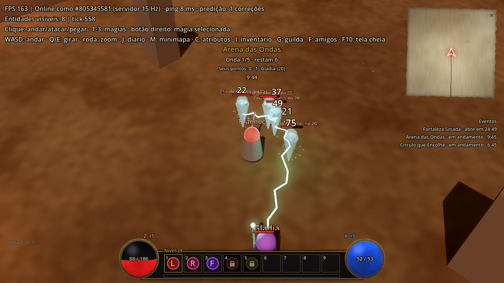

- **Horários:** o calendário agora tem os três eventos, cada um em 10 min do ciclo de 30 min: a Fortaleza no minuto 0, a Arena no 10 e o Círculo no 20. O contador da HUD lista os três.
- **Ingressos da Forja:**
  - Emblema da Arena: Osso em Brasa + Lágrima Consagrada;
  - Marca do Círculo: Pergaminho do Sitiante + Seiva Vital.

  Os dois custam 1.200 Óbolos e têm 80% de chance. Os materiais são os mesmos da Fortaleza.
- **Arena das Ondas** (até 10 por faixa, 10 min):
  - grade na largada; depois, 5 ondas: 8 e 12 Crias do Abismo, 7 e 10 Brutos Acorrentados, e 6 Brutos com o Campeão da Arena;
  - a próxima onda vem 8 s depois de a anterior acabar, ou por cima dela se a onda durar mais de 100 s;
  - cada morte vale pontos para quem matou (10 a Cria, 25 o Bruto, 300 o Campeão);
  - o painel mostra a onda, quantos monstros restam, os seus pontos e o líder;
  - **no fim** (ondas vencidas ou tempo esgotado), o ranking vai para todos. Cada ponto vale 60 de XP e 12 Óbolos; o 1º ganha Pedra da Gênese, Gema do Vórtice e Seiva Vital, o 2º Gema do Vórtice e Fragmento de Alma, e o 3º um Fragmento de Alma;
  - quem morre sai, mas leva o prêmio dos pontos se ainda estiver online no fim.
- **Círculo que Encolhe** (até 12 por faixa, 7 min):
  - **todos contra todos**, sem infâmia, herói ou penalidade; grupo e guilda não protegem;
  - **sem itens de fora:** o equipamento não dá bônus lá dentro (só atributos e magias), e consumíveis não funcionam;
  - 8 Guardas do Círculo pelo caminho;
  - o **anel** começa com 26 m e fecha até 4 m entre 40 s e 330 s; quem fica fora perde 6% da vida por segundo, até na antessala;
  - no cliente, o anel é uma parede roxa translúcida que encolhe, e o painel avisa "FORA DO ANEL";
  - **vence o último de pé**; no fim do tempo, quem tem mais pontos entre os vivos (5 por jogador derrubado, 1 por guarda);
  - o vencedor ganha 1.200 × nível de XP, 6.000 Óbolos e quatro joias; os outros ganham XP pelos pontos;
  - com menos de 2 lutadores na largada, o evento é **cancelado e o ingresso volta**.

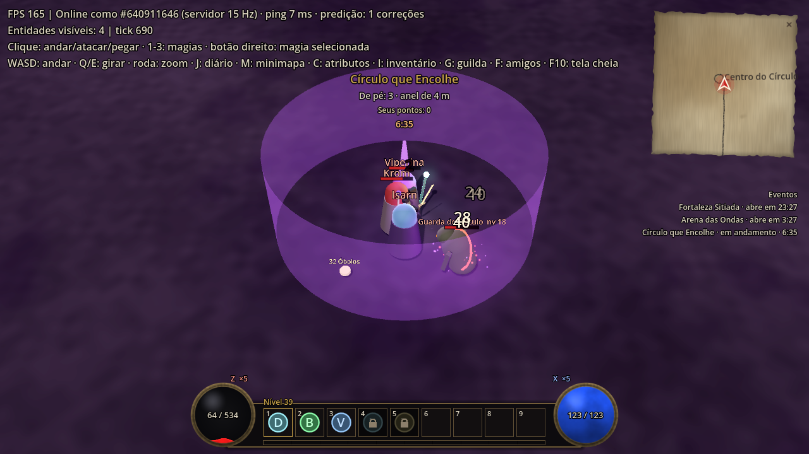

- **Protocolo v16** (o painel ganhou uma segunda linha e o anel).
- **Correção:** o efeito de projétil guardava o alvo de um jeito que, quando o alvo morria no meio do voo, gerava avisos "Lambda capture ... was freed" no cliente. Isso apareceu com as ondas da Arena; agora são 0 avisos.

**Verificado:**
- **Testes:** 71 passam. Os novos cobrem:
  - o ranking da Arena;
  - o raio do anel (começo, metade e fim);
  - a última onda com o campeão;
  - as regras de PvP e itens das regiões;
  - as receitas dos dois ingressos;
  - as faixas de cada tipo de evento;
  - as antessalas seguras e isoladas pela grade, e os pontos de nascimento no chão andável.
- **Arena, dois bots:**
  - os ingressos são recusados antes da abertura;
  - as cinco ondas, até o Campeão, terminam em "Todas as ondas vencidas!" (o GM adiantou as ondas mais demoradas);
  - o ranking deu "1º Tharos 135 · 2º Gladia 50", com XP, Óbolos e os itens do pódio;
  - numa rodada sem GM até o fim, deu "fim do tempo" na onda 4, também com o ranking pago.
- **Círculo, dois bots:**
  - o equipamento deixou de valer (dano máximo 80 → 31, que volta a 80 na saída);
  - as poções são recusadas;
  - o anel fechou (GM);
  - um bot derrubou o outro (PvP livre, sem infâmia) e venceu com o prêmio; o perdedor ganhou XP pelo ponto.
- **Círculo, um bot só:** cancelado, com a Marca devolvida.
- **Relógio de verdade:** durante um teste, a Fortaleza abriu sozinha no horário.
- **Cliente gráfico:** dentro da Arena (onda 1, painel com pontos e líder) e dentro do Círculo com o anel fechado em 4 m, ao lado dos bots.
- **Regressão:** a Fortaleza (vitória), PvP e guildas passam como antes.
- **Web:** a build tem 38,77 MB.

**Ainda não verificado:**
- a faixa 2 dos dois eventos;
- muitos jogadores ao mesmo tempo;
- o anel fechando pelo tempo inteiro (nos testes, o GM o fechou de vez);
- os eventos na Web no navegador.

**Debug:** GM `event arena|circulo open | start | skip | end` (`skip`: na Arena, acaba a onda atual; no Círculo, fecha o anel); bots `--bot-event=lead:arena`, `help:circulo`, `--bot-solo`; cliente `--add-stat=atributo:quantidade`.

### Parte 1: eventos com horário e a Fortaleza Sitiada — entregue
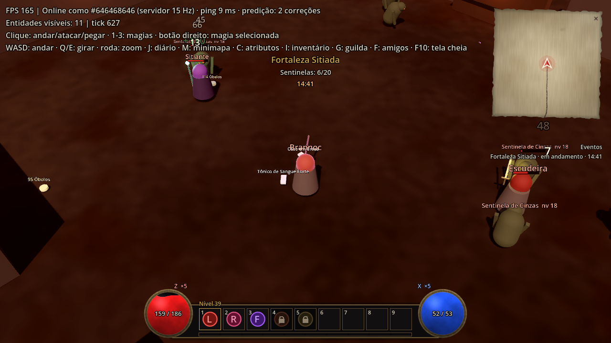

- **Calendário** (`data/scheduled_events.json`), pelo relógio do servidor (UTC). A Fortaleza começa a cada 30 min, no minuto 0 e no 30.
  - Avisos: 5 min antes de abrir ("Os portões abrem em 5 min") e na abertura ("Os portões estão abertos!"), com o ingresso e as faixas de nível.
  - Os portões ficam abertos 3 min antes do começo, e o evento dura 15 min.
  - **Contador na HUD**, no canto direito: "abre em", "PORTÕES ABERTOS" (em dourado), "em andamento", com contagem regressiva.
- **Ingresso:** o Selo da Fortaleza (botão direito para usar), gravado na Forja do Vórtice com Pergaminho do Sitiante + Osso em Brasa + Fragmento de Alma (80%, 1.500 Óbolos).
  - Os dois materiais caem no Bosque, na Geleira, nos chefes, nas invasões e na própria Fortaleza.
  - Fora da hora, o selo não é gasto e diz quando abre.
- **Faixas de nível com instâncias separadas:**

  | Faixa | Níveis | Monstros |
  |---|---|---|
  | 1 | 15 a 39 | Sentinela de Cinzas, Portão da Fortaleza, Guardião Profanado |
  | 2 | 40 ou mais | versões antigas, muito mais fortes |

  Cada faixa tem a sua cópia da região (id `fortaleza@1`, `fortaleza@2`), para até 10 jogadores. A instância é criada quando o primeiro entra e apagada no fim.
- **A Fortaleza:**
  1. a espera é na antessala (zona segura); na largada, a grade desce e abre o pátio;
  2. o pátio tem sempre 7 sentinelas; com 20 mortas, as runas do portão se apagam (antes disso o golpe mostra "protegido");
  3. derrubado o portão, a muralha se abre e o salão desperta: 6 sentinelas e o Guardião Profanado;
  4. o Guardião deixa a Relíquia Ardente com quem mais o feriu; levá-la ao Altar do Guardião vence o evento (aviso a todos).
  - **Recompensa** para todos que estão dentro: 900 × nível de XP, 4.000 Óbolos, uma Lágrima Consagrada e um Fragmento de Alma; quem entrega ganha também Gema do Vórtice, Pedra da Gênese e Seiva Vital. Na faixa 2 os valores são maiores.
  - **Derrota:** o tempo acaba, ou todos saem ou morrem (quem morre renasce no Refúgio e sai do evento).
  - Depois de 20 s todos voltam ao Refúgio.
  - Dentro da Fortaleza não há PvP, não se usa o Pergaminho do Retorno e o teletransporte não leva lá.
- **Painel do evento** no alto da tela: nome, etapa (sentinelas x/20, "Derrubem o portão!", "Vençam o Guardião", relíquia com quem) e o tempo.
- **Grade e portão:** são bloqueios que abrem (`dynamic_blockers` nos dados da região), aplicados na mesma grade de navegação no servidor e na predição do cliente. A grade desce no chão quando abre.
- **Protocolo v15.**
- **Correção:** o brilho de chegada do teletransporte passou a usar um código próprio; desde a parte 3 da Fase 5 ele mostraria "EVOLUÇÃO!".

**Verificado:**
- **Testes:** 69 passam. Os novos cobrem:
  - o cálculo do próximo horário (antes, durante e depois da abertura, com deslocamento);
  - as faixas sem buraco, os monstros e os ingressos de cada evento;
  - a receita do selo reconhecida pela Forja;
  - os pontos de nascimento andáveis;
  - a grade isolando a antessala e o portão isolando o salão, até abrirem;
  - só a antessala ser segura.
- **Dois bots** (Feiticeiro e Cavaleiro, nível 39; GM só para abrir, largar e adiantar uma etapa):
  - o selo é recusado antes da abertura;
  - os dois entram na mesma instância da faixa 1;
  - a grade abre, as sentinelas contam até 20, o portão é derrubado e o Guardião desperta;
  - a relíquia vai para a Cavaleira (quem mais feriu o chefe), que a entrega no altar;
  - vitória, recompensas (35.100 de XP e 4.000 Óbolos cada, os itens a mais para quem entregou) e volta ao Refúgio;
  - o próximo horário é calculado.
- **Derrota:** testada numa rodada anterior, em que os bots não chegaram às 20 sentinelas: "A Fortaleza resistiu", sem recompensa.
- **Cliente gráfico:** entrou com o selo (`--use-item`), atravessou a grade aberta e lutou no pátio com os dois bots; o painel e o contador aparecem.
- **Regressão:** PvP, guildas, Vidente e viagem entre regiões passam como antes.
- **Web:** a build tem 38,71 MB.

**Ainda não verificado:**
- a faixa 2 (nível 40+) em combate;
- um grupo grande (10 jogadores);
- os avisos de 5 minutos e a abertura pelo relógio de verdade (nos testes, a abertura e a largada vieram do GM);
- o selo gravado na Forja pela janela (só a receita foi testada);
- a Web no navegador.

**Debug:** GM `event fortaleza open | start | skip | end` (`skip` adianta a contagem do pátio ou deixa o portão e o chefe com 10% da vida); bots `--bot-event=lead` / `help`; cliente `--use-item=base:segundos`.

## Fase 5 — Social e PvP (concluída)

**Plano em 3 partes:** (1) PvP com consequências: Fora da Lei e Herói; (2) guildas (mestre, cargos, símbolo em pixels, guerra de guildas, chat da guilda) e lista de amigos; (3) mais duas classes (Cavaleiro Profano e Vidente do Véu) e evolução de classe por missão.

### Parte 3: duas classes novas e evolução de classe — entregue
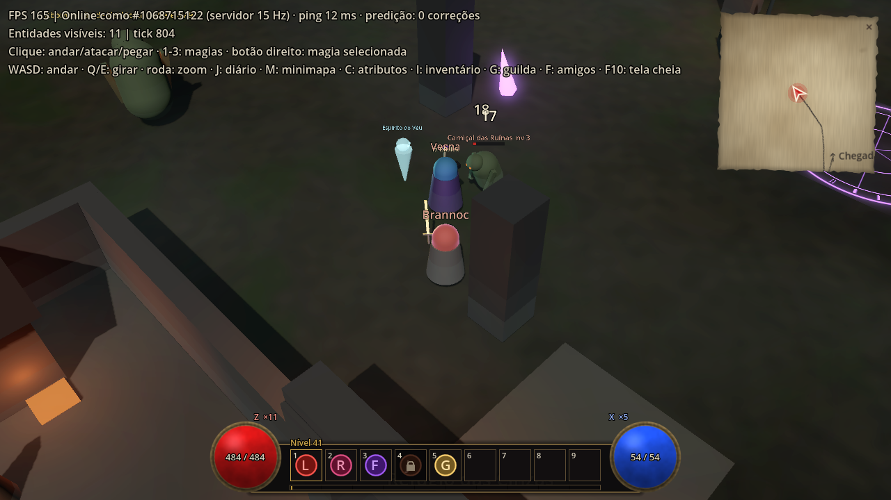

- **Escolha de classe** ao criar o personagem (três botões com a descrição de cada uma). A lista de personagens mostra a classe ou o título da evolução.
- **As três classes** (`data/classes/`):

  | Classe | Papel | Atributos iniciais (for/agi/vit/ene) | Arma |
  |---|---|---|---|
  | Feiticeiro Abissal | magias de área, muito dano | 18 / 18 / 15 / 30 | cajados |
  | Cavaleiro Profano | corpo a corpo, muita vida e defesa; dano vem da força | 28 / 20 / 25 / 10 | espadas (novas) |
  | Vidente do Véu | à distância e suporte: cura, proteção, invocação | 15 / 24 / 18 / 28 | cajados |

- **Magias do Cavaleiro:** Golpe Profano (ataque básico corpo a corpo), Lâmina Rubra, Redemoinho Profano (acerta todos em volta), Fenda Sombria (área a até 6 m), Juramento Sombrio (grimório: +25% de dano e +10 de defesa por 20 s).
- **Magias da Vidente:**
  - Toque do Véu (ataque básico) e Dardo Espectral;
  - Bênção Curativa: cura você e o grupo num raio de 8 m;
  - Véu Protetor: +15 de defesa e 10% de absorção por 30 s, também para o grupo;
  - Invocar Espírito (grimório): um Espírito do Véu segue você por 40 s e ataca o monstro mais próximo. O dano conta para você.
- **Itens novos:**
  - três espadas: Espada Enferrujada (nível 1), Lâmina do Penitente (nível 6) e Montante do Eclipse (nível 15). A magia canalizada aparece como brilho na lâmina;
  - a Cota de Cinzas, armadura do Cavaleiro;
  - dois grimórios na loja da Alquimista.

  As armas e os grimórios dizem para quais classes servem; a dica fica em vermelho quando o item não é da sua classe, e o servidor recusa equipar ou usar.
- **Evolução por missão** com o **Ancião Varek** (novo NPC no Refúgio, atrás do braseiro). A missão é "O Juramento das Cinzas", a partir do nível 20, com um texto para cada classe:
  1. derrotar 30 criaturas na Geleira (contam as mortes do grupo na mesma região);
  2. trazer o Selo do Juramento Antigo, que vai direto para a mochila de quem ajudar a derrubar o Colosso da Geleira.

  Ao entregar o selo, o personagem evolui:

  | Classe | Evolui para | Magia nova (tecla 5) |
  |---|---|---|
  | Feiticeiro Abissal | Arquimago do Abismo | Meteoro do Vazio |
  | Cavaleiro Profano | Cavaleiro do Eclipse | Golpe do Eclipse |
  | Vidente do Véu | Oráculo do Véu | Bênção do Oráculo (+15% de dano e de vida para o grupo) |

  Quem evolui também ganha +10 pontos na hora, +2 pontos por nível dali em diante e uma luz dourada aos pés, e todos recebem um aviso.
- **HUD:** os bônus ativos aparecem com contagem regressiva acima da barra. A etapa da missão aparece embaixo do minimapa. A janela de atributos mostra a classe (ou o título) e chama o dano de "Dano" no Cavaleiro.
- **Banco:** migração para a versão 4 (colunas `evolution` e `quests`). Personagens antigos continuam Feiticeiros; a magia nova do Feiticeiro entrou no fim da lista, então as magias aprendidas não mudam. **Protocolo v14.**

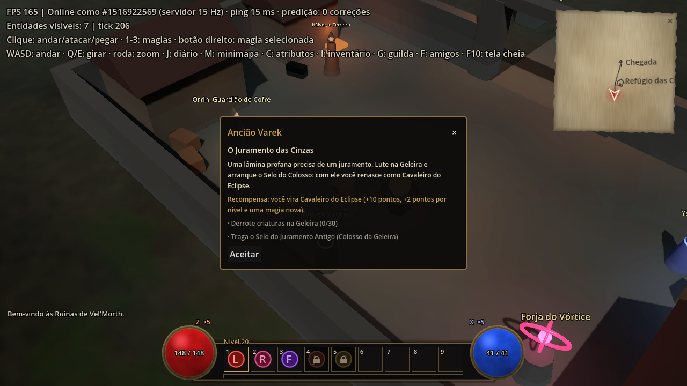

**Verificado:**
- **Testes:** 66 passam. Os novos cobrem:
  - as fórmulas das três classes (vida: Cavaleiro > Vidente > Feiticeiro; a Vidente bate menos que o Feiticeiro);
  - os tipos de magia e os campos das invocações;
  - um bônus temporário somando e saindo dos atributos;
  - a restrição de itens por classe e a dica em vermelho;
  - as regras da missão (região certa, troca de etapa, entrega com e sem o selo);
  - a evolução e a missão salvas no banco;
  - os dados das três classes (ataque básico, teclas repetidas, itens iniciais, grimórios da classe certa).
- **Bots:**
  - **Cavaleiro** lutando sozinho: 9 monstros em 45 s, sem morrer.
  - **Vidente:**
    - o Véu Protetor funciona na cidade e aparece na lista de bônus;
    - invocar na cidade é recusado;
    - fora da cidade o Espírito apareceu e atacou 14 vezes;
    - 6 monstros mortos, com cura.
  - **Evolução** (Cavaleiro; a contagem foi adiantada pelo GM para 29 de 30, e o selo veio pelo GM):
    - a magia 5 é recusada antes da evolução, com a dica do Ancião;
    - entregar sem ter aceitado não faz nada;
    - a missão é aceita na janela do Ancião;
    - uma morte real na Geleira concluiu a etapa;
    - o selo é entregue (e sai da mochila);
    - o personagem vira Cavaleiro do Eclipse: +10 pontos, a magia 5 aprendida e, no nível 41, 280 pontos (7 por nível).
- **Cliente gráfico:** tela de criação com as três classes e o personagem evoluído na lista; o Cavaleiro com espada ao lado da Vidente e do Espírito do Véu em combate; a janela do Ancião.
- **Regressão:** os bots de PvP, de guildas e o Feiticeiro lutando passam como antes.
- **Web:** a build tem 38,67 MB.

**Ainda não verificado:**
- o selo caindo de um Colosso derrubado de verdade (no teste ele veio pelo GM);
- as magias novas lançadas com teclado e mouse no cliente gráfico (as capturas mostram as magias dos bots);
- os efeitos de Redemoinho, Fenda e Meteoro vistos de perto;
- a Bênção Curativa e o Véu no grupo de outro jogador;
- PvP com golpes corpo a corpo;
- a Web no navegador.

**Debug:** bot `--bot-class=<classe>` (classe do personagem novo), `--bot-classtest=support` / `evolve`; cliente `--login=conta:senha:Nome:classe`; GM `quest <id> <etapa> [contagem]`, `quest <id> done|reset` e `evolve`.

### Parte 2: guildas e lista de amigos — entregue
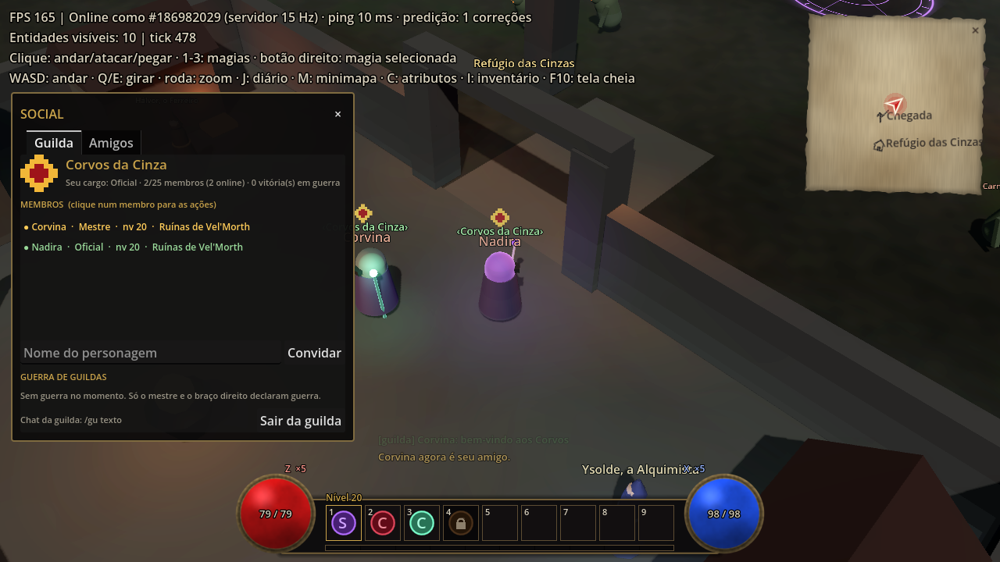

- **Janela social:** G abre a aba Guilda e F a aba Amigos (ou o × e Esc para fechar). Enquanto ela está aberta, o chat vai para o lado.
- **Fundar uma guilda:** nome (de 3 a 16 letras, números e espaços) e símbolo desenhado num **editor de pixels 8×8** com 15 cores (botão esquerdo pinta, arrastando pinta vários; direito apaga). Precisa de nível 15, custa 5000 Óbolos e só se funda na cidade. Todos recebem o aviso "Nova guilda".
- **Cargos** (`guilds.json`):

  | Cargo | Quantos | Convida | Expulsa | Declara guerra |
  |---|---|---|---|---|
  | Mestre | 1 | sim | sim | sim |
  | Braço Direito | 1 | sim | sim | sim |
  | Oficial | 3 | sim | não | não |
  | Membro | sem limite | não | não | não |

  - Ninguém expulsa quem tem cargo igual ou acima do seu.
  - Só o mestre promove, rebaixa, passa a liderança (os dois trocam de cargo), muda o símbolo e desfaz a guilda (dois cliques para confirmar).
  - O mestre não pode sair: passa a liderança ou desfaz a guilda.
  - Até 25 membros; o convidado precisa ter nível 6.
- **Lista de membros:** online ou offline, cargo, nível e região. Clicar num membro abre as ações que o seu cargo permite.
- **Sobre a cabeça:** o símbolo e o nome da guilda entre ‹ ›, em verde para a sua guilda, vermelho para a inimiga em guerra e dourado para as outras.
- **Chat da guilda:** `/gu texto`, em verde. Também `/gconvidar Nome`, `/amigo Nome` e as opções novas no clique sobre um jogador ("Convidar para a guilda", "Adicionar amigo").
- **Guerra de guildas:**
  - o mestre ou o braço direito declara guerra pelo nome da outra guilda;
  - quem pode decidir na outra guilda recebe o convite e aceita ou recusa;
  - todos recebem o aviso "Guerra de guildas!";
  - durante a guerra, os membros das duas guildas se atacam fora da cidade **sem infâmia**, e cada morte soma no placar;
  - vence quem chegar a 10 mortes, ou quem tiver mais quando os 15 minutos acabarem (empate se igual);
  - a vitória fica salva na guilda e aparece na janela.
  - Membros da mesma guilda não se atacam.
- **Amigos:** pedido e aceite, e a amizade vale para os dois lados. A lista mostra quem está online, o nível e a região, com botões Sussurrar e Remover (dois cliques). Os amigos recebem um aviso quando você entra ou sai do jogo. Limite de 30 amigos.
- **Banco:** migração para a versão 3 com as tabelas `guilds`, `guild_members` e `friends`. Cada mudança é gravada na hora. Ao abrir, o servidor carrega todas as guildas, inclusive os membros offline.
- **Protocolo v13.**

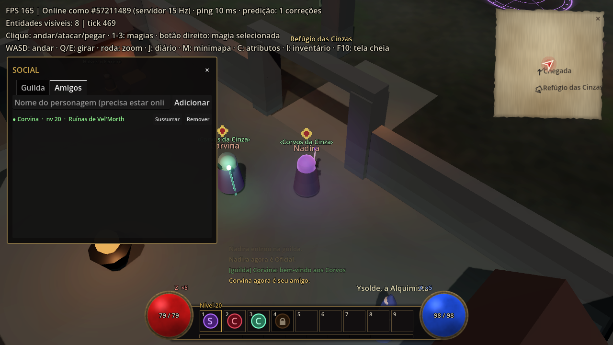

**Verificado:**
- **Testes:** 60 passam. Os novos cobrem:
  - os nomes válidos e inválidos;
  - o símbolo: vazio, tamanho errado, cor fora da paleta;
  - quem pode expulsar quem;
  - o placar e o vencedor da guerra;
  - guildas e amigos no banco, e o servidor recarregando a guilda do banco;
  - a migração de um banco da versão 1 até a 3.
- **Dois bots** (`--bot-guild=a:Outro` e `b:Outro`):
  - nome inválido e símbolo vazio recusados;
  - fundação de "Corvos da Cinza" (cobrou 5000 Óbolos);
  - convite aceito, promoção a Oficial, chat da guilda nos dois sentidos;
  - amizade pedida e aceita;
  - o mestre tentou sair e foi impedido;
  - o oficial saiu e fundou "Lobos do Véu";
  - guerra declarada e aceita;
  - fora da cidade, o mestre dos Corvos derrubou o outro: placar 1 × 0, **sem infâmia** (status PvP [0, 0]);
  - a guerra terminou com 1 vitória salva;
  - os Lobos foram desfeitos;
  - o amigo recebeu o aviso "saiu do jogo".
- **Cliente gráfico:** janela da guilda com membros, cargos e regiões; aba de amigos; símbolo e nome da guilda sobre os dois personagens; chat deslocado.
- **Regressão:** os bots de PvP (Fora da Lei e Herói) e de grupo e troca passam como antes.
- **Web:** a build tem 38,62 MB.

**Ainda não verificado:**
- o editor de símbolo e os botões usados com o mouse de verdade (as capturas abriram a janela por argumento, e as ações vieram dos bots);
- a cor vermelha da guilda inimiga no cliente gráfico durante uma guerra;
- uma guerra terminando pelo tempo (15 minutos) e não pelo comando de GM;
- as guildas na build Web dentro do navegador.

**Debug:** bots `--bot-guild=a:NomeDoOutro` / `b:NomeDoOutro`; GM `guildwar <s>` (a guerra da sua guilda acaba em N s); cliente `--open-guild` e `--open-friends`.

### Parte 1: PvP, Fora da Lei e Herói — entregue
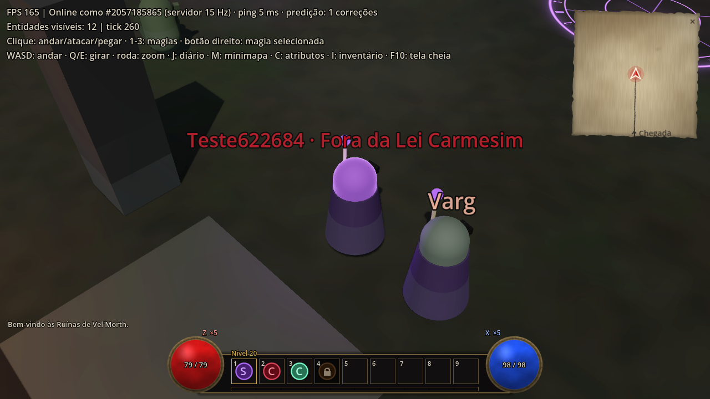

- **Atacar outro jogador:** Ctrl+clique (ataque básico contínuo) ou Ctrl+tecla de magia com o mouse sobre ele. Só magias de alvo único atingem jogadores; as de área e a corrente não. O dano entre jogadores vale 60% (`pvp.json`).
- **Regras, conferidas no servidor:**
  - nada de luta em zona segura;
  - os dois precisam ter nível 6 ou mais;
  - os dois na mesma região;
  - membros do mesmo grupo não se atacam.
- **Autodefesa:** quem é atacado sem motivo pode revidar o agressor sem penalidade por 60 s, e recebe um aviso.
- **Fora da Lei:** matar sem motivo soma 1 de infâmia. O nome muda de cor e ganha o título:

  | Infâmia | Status | XP perdida ao morrer | Chance de deixar cair um item | Lojas |
  |---|---|---|---|---|
  | 1 | Fora da Lei (laranja) | 5% | 15% (da mochila) | atendem |
  | 3 | Fora da Lei Rubro (vermelho) | 10% | 35% (da mochila) | recusam |
  | 6 | Fora da Lei Carmesim | 20% | 60% (até equipado) | recusam |

  - Ao subir de nível de infâmia, todos recebem um aviso.
  - A infâmia cai 1 ponto a cada 20 minutos online ou a cada 40 monstros mortos.
- **Herói:** derrubar um Fora da Lei sem ser um soma pontos de herói (1 ponto = Herói, 5 = Herói Lendário), com nome azul e aviso a todos ao subir de nível.
- **Salvo no banco:** a infâmia e os pontos de herói. O banco agora tem **migrações por versão**: um banco antigo (versão 1) ganha as colunas novas ao abrir, sem perder nada.

**Verificado:**
- **Testes:** 55 passam. Os novos cobrem os níveis por infâmia e por pontos de herói, e a **migração de um banco da versão 1** com um personagem: ele volta igual, a infâmia passa a ser salva e abrir de novo não migra duas vezes.
- **Dois bots (agressor e vítima):**
  - ataque dentro da cidade recusado ("Não se luta numa zona segura");
  - a vítima recebeu a autodefesa;
  - o agressor a matou e virou Fora da Lei;
  - a vítima renasceu, voltou e derrubou o Fora da Lei (justificado), virando Herói;
  - o Fora da Lei perdeu XP e deixou cair um Tônico;
  - com infâmia 6, a Alquimista recusou atendimento ("não atende Fora da Lei");
  - o servidor registrou as duas mortes com justificado sim/não.
- **Regressão:** combate e cidade continuam funcionando.
- **Cliente gráfico:** nome carmesim com título ao lado de um jogador comum.
- **Web:** a build tem 38,56 MB.

**Ainda não verificado:** o Ctrl+clique com mouse e teclado de verdade (os bots mandam a intenção direto); o decaimento da infâmia com o tempo (20 minutos por ponto); e a cor de Herói vista no cliente gráfico.

**Debug:** bots `--bot-pvp=attacker:NomeDaVitima` e `--bot-pvp=victim:NomeDoAgressor`; GM `infamy <n>`.

## Fase 4 — Mundo (concluída)

**Plano em 3 partes:** (1) várias regiões, portais, uma folha do diário por região com virada de página e teletransporte só para regiões descobertas; (2) chefes de campo e invasões douradas; (3) asas tier 1.

### Parte 3: asas tier 1 — entregue
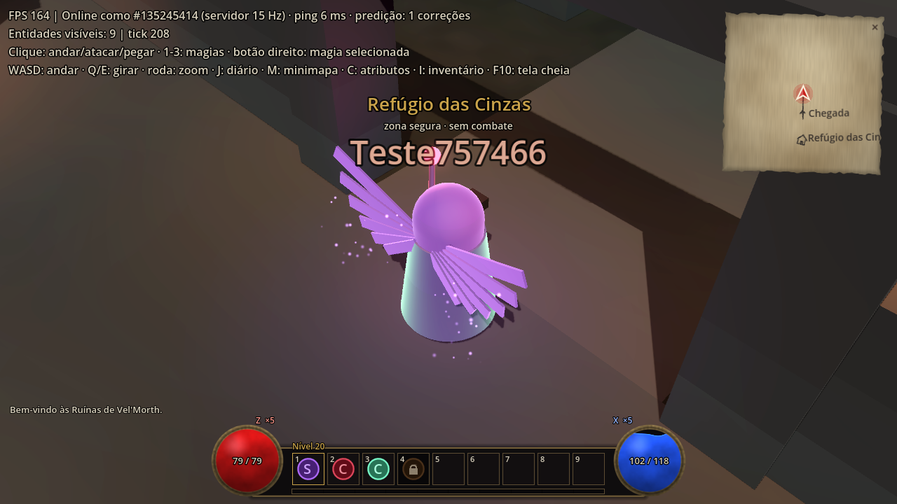

- **Dois pares de asas de nível 1** (`items.json`, slot "asas"), a partir do nível 15, refináveis como as outras peças:

  | Asas | Defesa | Dano | Absorção | Extra |
  |---|---|---|---|---|
  | Asas de Fuligem | +10 | +10% | 10% | — |
  | Asas do Véu Rasgado | +7 | +14% | 6% | +20 de mana |

- **Criadas na Forja do Vórtice** (receita `asas_t1`):
  - sacrifica 1 equipamento +7 ou mais, junto com 2 Gemas do Vórtice, 1 Pedra da Gênese, 1 Fragmento de Alma e 6000 Óbolos;
  - a chance é de 30% com um item +7, mais 5% por nível acima, mais 5% se tiver Sorte e mais 10% se for Excelente ou Ancestral, até 70%;
  - o equipamento é consumido com sucesso ou não, e a janela avisa antes;
  - o par de asas é sorteado. Quando dá certo, **todos recebem o aviso** "Asas forjadas!". Asas não servem de sacrifício.
- **Visual nas costas:** duas asas em leque de penas longas que **batem devagar**, com brasas na cor do brilho do item caindo das pontas. O brilho de refino (+7, +9, +11) e o contorno de raridade valem para as asas como para o resto do equipamento. Os outros jogadores também veem.
- Ícone próprio no inventário e linhas de dano, absorção e nível das asas no tooltip.

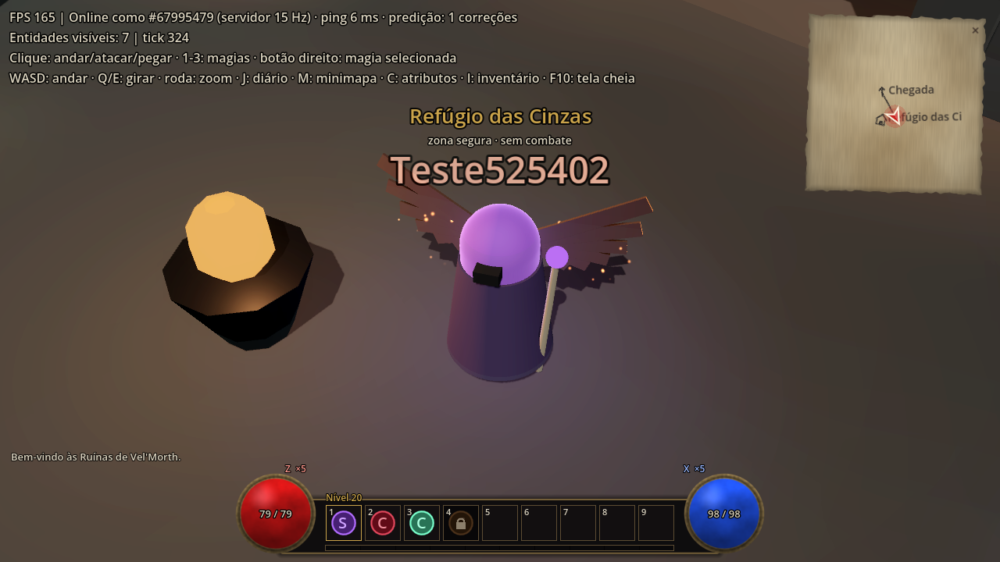

**Verificado:**
- **Testes:** 53 passam. O novo confere a receita: item +6 recusado explicando o mínimo, chance com +7 e com +10, Sorte e Excelente, teto de 70%, asas recusadas como sacrifício, o refino superior ainda reconhecido com as joias dele e que os resultados são mesmo asas.
- **Bot das asas:** na forja da cidade, um Manto Excelente +12 com Sorte deu 70%; saíram as Asas de Fuligem já na primeira tentativa; o manto foi consumido; o bot equipou as asas e a defesa foi de 11 para 21.
- **Regressão:** o roteiro antigo da forja (joias, refino +9 → +10 com selo) continua igual.
- **Cliente gráfico:** capturas das duas asas no personagem (+11 com aura e +7).
- **Web:** a build tem 38,55 MB.

**Ainda não verificado:** a falha da receita das asas num teste ao vivo (a lógica é a mesma das outras receitas e está nos testes da prévia) e o efeito das asas no combate medido em números (os bônus de dano e absorção entram pelas mesmas chaves já usadas pelas opções excelentes).

**Debug:** bot `--bot-wings`.

### Parte 2: chefes de campo e invasões douradas — entregue
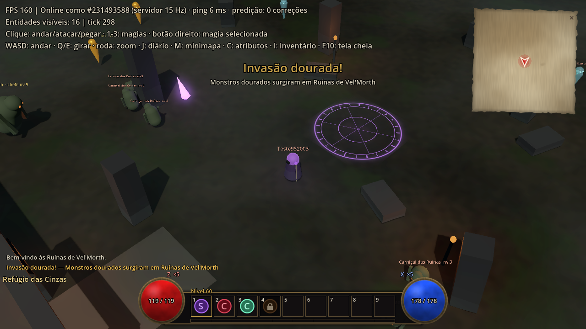

- **Um chefe de campo por região**, com renascimento temporizado (dados em `monsters.json` e `monster_spawns` da região):

  | Chefe | Região | Nível | Renasce em |
  |---|---|---|---|
  | Abominação de Vel'Morth | Ruínas | 9 | 10 min |
  | Mãe-Loba Cinzenta | Bosque | 17 | 15 min |
  | Colosso do Inverno | Geleira | 28 | 20 min |

  - Chefes são maiores, têm nome dourado e luz própria, dão 6× a XP e soltam 4 a 6 itens de tabelas próprias (muitas joias).
  - Ao renascer: aviso "Um chefe despertou" para todos. Ao morrer: "Chefe derrotado! … caiu diante de <jogador>", e **uma caveira com o nome do chefe é desenhada no diário de cada um que ajudou**.
- **Invasões douradas** (`data/events.json`):
  - de 15 a 25 minutos (a primeira 3 minutos depois de o servidor subir), uma região sorteada por peso recebe 7 ou 8 monstros dourados, espalhados longe da cidade e dos portais;
  - monstros dourados são variantes geradas dos dados (3× vida, 1,4× dano, 4× XP), com o corpo todo em ouro brilhante, e soltam 2 itens da tabela da invasão (muitas joias);
  - termina quando todos morrem ("Invasão contida") ou depois de 5 minutos (os que sobraram somem na névoa);
  - avisos com a faixa no alto da tela e uma linha no chat, para todos os jogadores.
- **As variantes douradas são geradas igualzinho no servidor e no cliente** (`MonsterCatalog`), então o protocolo do snapshot não mudou: só o índice dos tipos cresceu (protocolo v11).
- **Comandos de GM:** `invasion [região]` começa uma invasão agora; `boss` faz o chefe da região renascer.

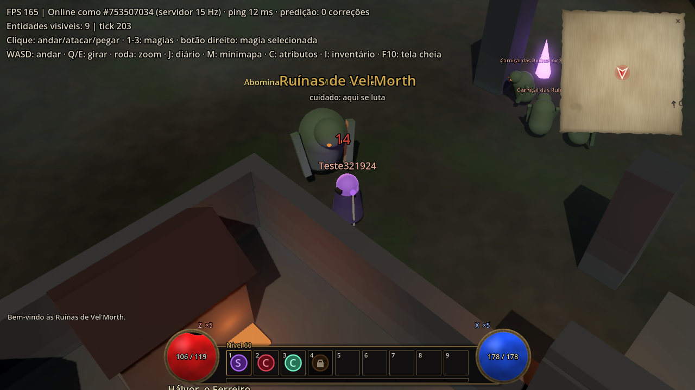

**Verificado:**
- **Testes:** 52 passam. O novo confere as variantes douradas (vida, drop, visual), a ordem estável dos tipos, um chefe por região com renascimento longo e que toda invasão aponta para regiões e monstros que existem.
- **Bot de eventos:** forçou uma invasão nas Ruínas, viu os monstros dourados, matou os 8 em 65 s (cada um soltou 2 itens: Pedra da Gênese, Seiva Vital, anéis excelentes, Óbolos) e recebeu "Invasão contida". Depois derrubou a Abominação (6 itens no chão), recebeu "Chefe derrotado!" e a caveira foi desenhada no diário.
- **Cliente gráfico:** capturas do chefe (maior, atacando) e da invasão (Espectros dourados e a faixa de aviso).
- **Web:** a build tem 38,54 MB.

**Ainda não verificado:** o fim da invasão por tempo (só testei a invasão contida); o aviso de renascimento de chefe; os chefes do Bosque e da Geleira em combate; e se a dificuldade dos chefes faz sentido para um grupo que subiu jogando (testei com um personagem de nível 60 dado por GM).

**Debug:** bot `--bot-events`; GM `invasion` e `boss`.

### Parte 1: regiões, portais, folhas do diário e teletransporte — entregue
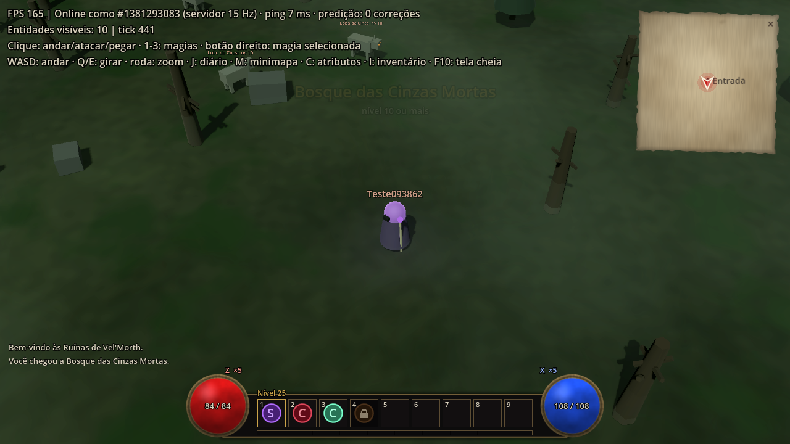

- **Três regiões rodando ao mesmo tempo no mesmo servidor** (`data/world.json`), cada uma com grade de navegação, monstros, drops, NPCs, zonas seguras e portais próprios (`RegionInstance`):
  - **Ruínas de Vel'Morth** (nível 1): a cidade e os primeiros monstros;
  - **Bosque das Cinzas Mortas** (nível 10): árvores mortas, Lobos de Cinza e Troncos Podres;
  - **Geleira dos Sussurros** (nível 20): espinhos e blocos de gelo, lago congelado, Espectros Gélidos e Golens de Gelo Antigo.
- **Cenário procedural determinístico:** a mesma semente gera as mesmas árvores e pedras no servidor (colisão) e no cliente (visual), com trilhas e áreas livres nos portais. Um teste garante que o cenário não muda entre montagens.
- **Portais** com anel de pedra e véu girando, mostrando o destino. Entrar no portal leva à outra região, chegando ao lado do portal de volta. Abaixo do nível mínimo, "O portal resiste: … exige nível 10".
- **Cada região tem a sua folha no diário.** Ao trocar de região, a folha antiga (com o caminho e os nomes) **vira como a página de um caderno**, revelando a folha da região nova. Portais viram marcações (símbolo de espiral).
- **Teletransporte pelo diário (J):** um painel "Viajar" lista **só as regiões que já têm folha**, com nível e custo (50, 300 e 800 Óbolos). O servidor confere de novo a folha, o nível, o saldo e se você está numa troca.
- **Morrer fora da cidade** faz renascer no Refúgio. O Pergaminho do Retorno leva à cidade de qualquer região.
- **Interesse por área separado por região:** só se vê o que está na própria região. Troca, grupo (XP dividida) e ataques respeitam a região.
- **A região é salva:** ao relogar, você volta à região e ao ponto onde estava, com todas as folhas.
- **Monstros novos** com tabelas de drop próprias, com mais Óbolos, armas melhores, joias e tônicos fortes.

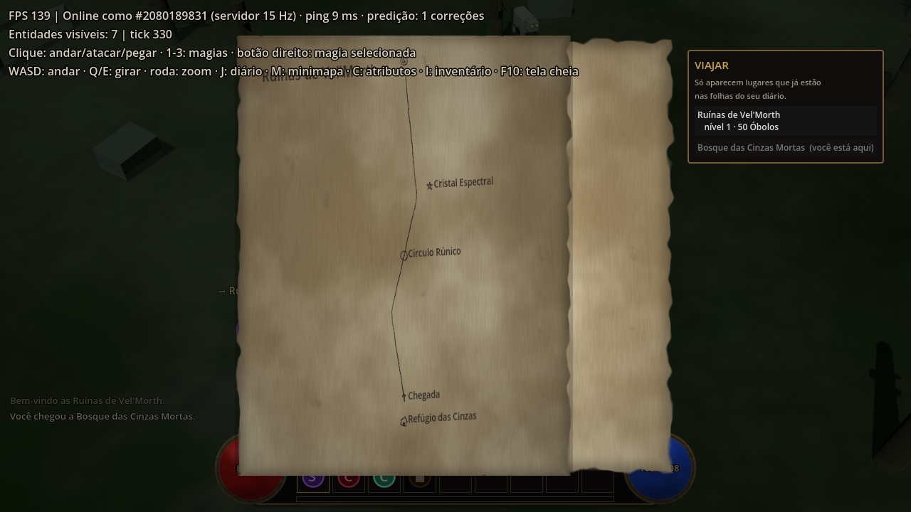
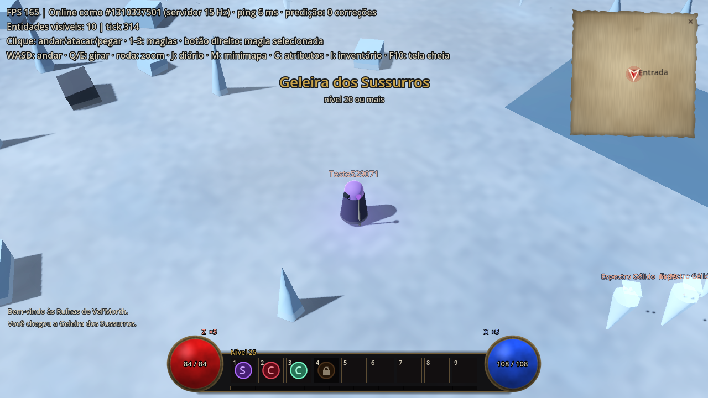

**Verificado:**
- **Testes:** 51 passam. Os novos conferem:
  - a consistência das regiões e dos portais (os dois lados batem, a chegada fica fora do raio do portal, os níveis crescem, há marcação no diário);
  - que pontos de chegada e portais estão em lugar andável e que dá para andar da chegada até cada portal;
  - que o cenário é determinístico.
- **Bot de viagem:**
  - barrado no portal com nível 1;
  - com nível 25, passou para o Bosque e chegou em (0, 30), com a folha nova;
  - teletransporte para a Geleira recusado (sem folha);
  - teletransportes para as Ruínas (−50 Óbolos) e o Bosque (−300) funcionaram;
  - atravessou o Bosque por entre as árvores até o portal da Geleira.
- **Persistência:** ao relogar, o personagem voltou na Geleira com as três folhas.
- **Regressão:** cidade, combate (7 abates, nenhuma morte), troca e XP dividida continuam funcionando.
- **Cliente gráfico:** capturas das duas regiões novas e da virada de página no meio da animação, com o painel Viajar ao lado.
- **Web:** a build tem 38,52 MB e mostra o login sem erros.

**Ainda não verificado:** trocar de região na Web (o painel do navegador roda em segundo plano), o painel Viajar clicado com o mouse e o equilíbrio de combate nas regiões novas com um personagem que subiu de nível jogando (testei com nível 25 dado por GM).

**Debug:** comando de GM `goto <região> [x z]`; bot `--bot-travel`; cliente `--flip-shot=caminho.png:ms` (captura a virada de página).

## Fase 3 — Multiplayer (concluída)

### Parte 3: interesse por área, snapshots enxutos e predição — entregue
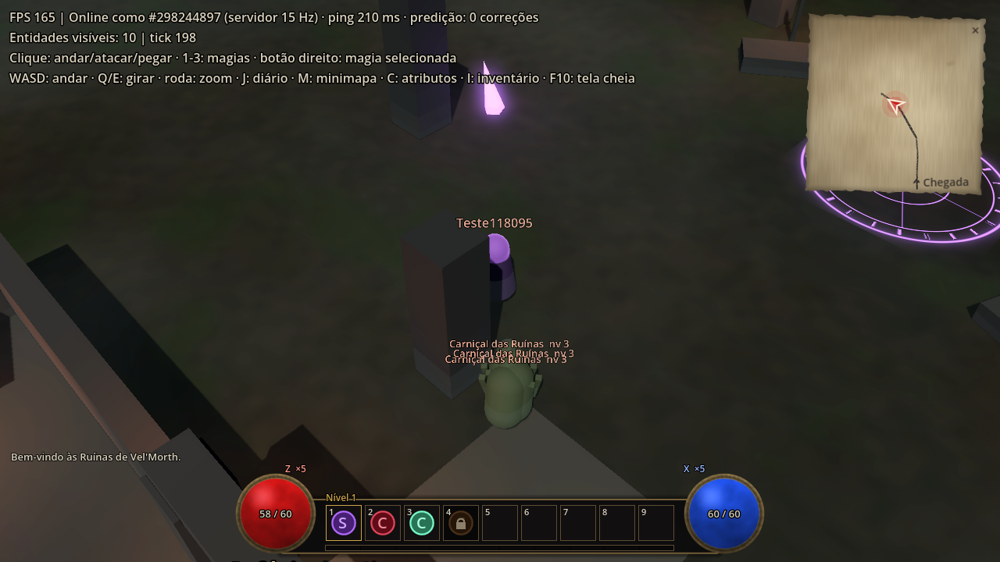

- **Interesse por área:**
  - cada jogador recebe só as entidades a até 32 m dele, com 4 m de folga para quem já estava visível, para não piscar na borda;
  - a busca usa uma grade espacial de células de 16 m, sem comparar todos com todos;
  - dano, magias, ataques, mortes, nível e efeitos de refino só vão para quem está perto;
  - nomes, aparência, drops e o chat geral continuam indo para todos (`network.json`).
- **Snapshot binário com delta por jogador** (protocolo v9):
  - posição em centímetros (int16), direção e vida num byte cada;
  - o tipo da entidade só vai na primeira vez que o jogador a vê;
  - quem não mudou custa 5 bytes (id + marcador);
  - por entidade: 15 bytes na primeira vez, 11 se mudou, 5 se ficou igual (antes eram 28, sempre).
- **Banda medida:** com cerca de 10 entidades visíveis, os snapshots ficaram em **~1 KB/s por jogador**. No formato antigo, as mesmas 10 entidades dariam ~3,6 KB/s (estimado pelo tamanho fixo de 24 bytes por entidade em 15 envios/s), e todo mundo recebia o mapa inteiro.
- **Predição do próprio movimento** (WASD e clique no chão):
  - o cliente roda o **mesmo código de movimento do servidor** (`ServerEntity.follow_path`, `NavGrid.slide`, `find_path`), com a grade montada da mesma cena, então o personagem responde na hora;
  - **reconciliação:** compara a posição do servidor com o que o cliente previu há uma ida e volta. Acima de 0,5 m, corrige deslizando; acima de 4 m (teleporte, renascimento), vai direto;
  - atacar, pegar item e falar com NPC continuam dirigidos pelo servidor, sem predição.
- **Ping** medido a cada 2 s e mostrado no canto, junto com o número de correções da predição.

**Verificado:**
- **Testes:** 48 passam. Os novos cobrem a ida e volta com precisão (ids grandes, cm, ângulo e vida), os tamanhos do delta, a entidade que sai e volta da área (o tipo é reenviado), snapshots malformados e a grade espacial.
- **Predição com atraso simulado** (`--sim-lag-ms=100`, ida e volta de ~210 ms): erro médio de 0,27 m, máximo de 0,41 m e **nenhuma correção** ao andar. Sem atraso: erro médio de 0,22 m. O erro de ~0,3 m é um tick do servidor andando a 5 m/s.
- **Interesse:** dois bots se veem na cidade. Quando um vai para (−16, −12), a uns 43 m, os dois deixam de se ver; o último ponto visto fica a ~36 m (32 + 4 de folga). Um bot parado na cidade recebe 4 a 5 monstros em vez dos 9.
- **Regressão:** combate (6 abates, nenhuma morte), roteiro da cidade, troca e XP dividida no grupo continuam iguais.
- **Na Web, pela primeira vez com interação:** no painel do navegador, criei conta e personagem pela tela de login, entrei no mundo, andei para fora do portão (o diário desenhou o caminho e a faixa de área apareceu) e ataquei um carniçal, com números de dano e quadro do alvo.

**Ainda não verificado:**
- O desempenho na Web numa aba em primeiro plano. O painel do navegador roda em segundo plano a ~1 FPS; nele, o ping aparece perto de 1 s e a predição faz correções porque o próprio cliente fica lento.
- Muitos jogadores ao mesmo tempo (testei até 2 bots e 1 cliente).

**Debug:** cliente com `--sim-lag-ms=N` (atraso de N ms em cada sentido) e `--prediction-report`; bot com `--bot-goto=x,z`; o servidor registra os KB/s dos snapshots a cada 5 s.

**Plano em 3 partes:** (1) contas, personagens e persistência em SQLite (inclusive o diário), com reconexão; (2) chat, grupo e troca entre jogadores; (3) rede: interesse por área, predição do próprio movimento e mensagens mais enxutas.

### Ajustes pedidos depois da parte 2
- **Seta estilo GPS** no lugar do lápis no diário e no minimapa: seta vermelha com contorno claro e halo pulsando, apontando para onde o personagem olha.
- **Ocultar o minimapa:** tecla M, o × no canto da folha ou o botão "Mapa (M)" para voltar. A escolha fica salva no cliente; o diário em tela cheia (J) continua disponível.

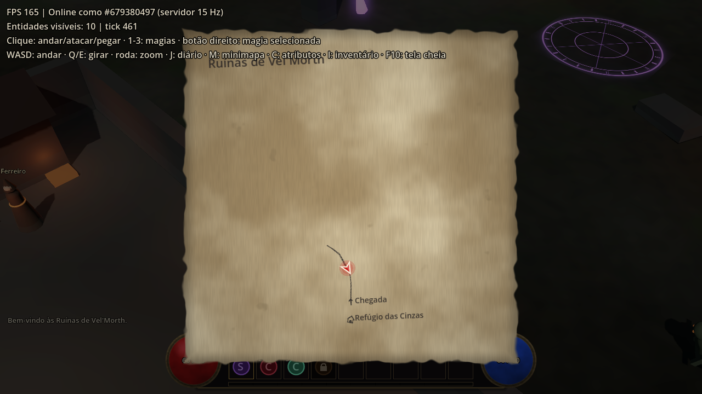

### Parte 2: chat, grupo e troca — entregue
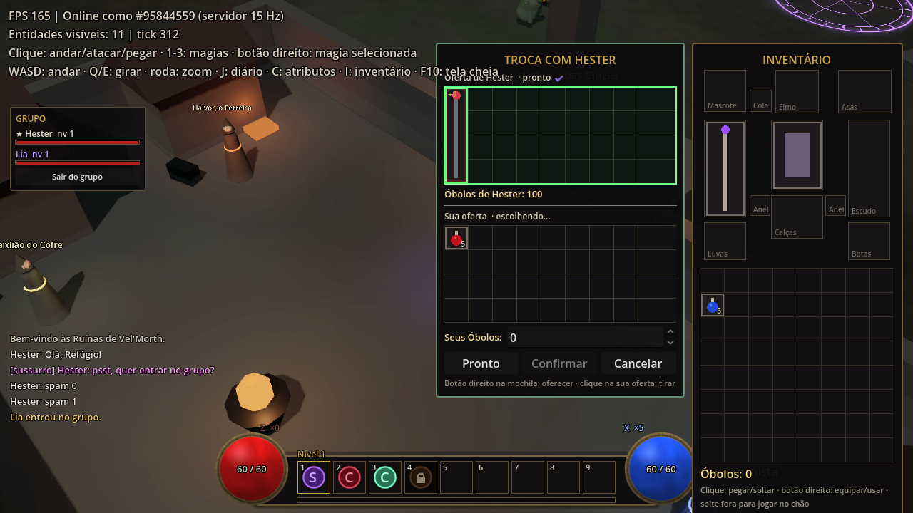

- **Chat** (canto inferior esquerdo, junto com as mensagens do jogo). Enter abre a linha; Esc fecha.
  - texto puro = geral; `/g` = grupo; `/s Nome texto` = sussurro; `/r` = responder ao último sussurro; `/ajuda`.
  - Cada canal tem uma cor. As linhas são texto simples, então nada do que um jogador digita vira formatação.
  - O servidor limpa caracteres de controle, corta em 160 caracteres e barra flood (6 mensagens a cada 8 s).
  - Enquanto você digita, WASD e Q/E não mexem no personagem nem na câmera.
- **Menu do jogador:** clique em outro jogador para sussurrar, convidar para o grupo ou propor troca. Os comandos `/convidar`, `/trocar`, `/sair` e `/expulsar` fazem o mesmo.
- **Convites** (grupo e troca) aparecem com Aceitar/Recusar e expiram em 30 s.
- **Grupo** de até 5, com quadro à esquerda (★ líder, nível e vida de cada um).
  - Só o líder convida e expulsa; se ele sai, o próximo assume; um grupo de 1 se desfaz.
  - **XP dividida** entre os membros vivos a até 30 m do monstro, proporcional ao nível, com +8% por membro a mais. Já existe o +10% por classe diferente, que vai valer quando houver outras classes.
  - Membros do grupo podem pegar os drops uns dos outros.
- **Troca com confirmação dupla:**
  - botão direito na mochila oferece; clique na sua oferta tira; também dá para oferecer Óbolos;
  - "Pronto" trava a sua oferta. Com os dois prontos, "Confirmar"; só com as duas confirmações o servidor troca;
  - qualquer mudança desmarca os dois lados;
  - antes de trocar, o servidor confere o saldo e o espaço na mochila dos dois (simulação no pior caso). Se faltar, avisa e destrava;
  - se afastar (mais de 6 m), morrer, cancelar ou sair devolve as ofertas;
  - os dois personagens são salvos **numa única transação** logo depois, e o servidor registra cada troca no log (itens com uid e Óbolos).
- **Regras durante a troca:** não se abre loja, cofre ou forja, e os itens oferecidos não podem ser usados nem equipados.

**Verificado:**
- **Testes:** 46 passam. Os 4 novos cobrem a limpeza do chat, a divisão de XP (distância, mortos, bônus por membro e por classe), a cópia da grade e a checagem de espaço da troca.
- **Dois bots (líder e membro):**
  - mensagem geral, sussurro e sussurro para quem não existe ("Ninguém não está online");
  - convite aceito e chat de grupo;
  - flood barrado depois da 2ª mensagem;
  - troca concluída: vara +9 e 100 Óbolos por 12 tônicos, que se empilharam na mochila do outro lado (5 + 12 = 17);
  - **o membro subiu de nível sem lutar**, só com a XP dividida;
  - registro da troca no servidor com os uids.
- **Cliente gráfico com um bot:** convite aceito, quadro do grupo, chat colorido e janela de troca com as duas ofertas (captura acima).
- **Web:** a build tem 38,43 MB e carrega sem erros de script.

**Ainda não verificado:** digitar no chat e clicar nos botões da troca com mouse e teclado de verdade (as capturas usam bots e `--auto-accept`); um membro do grupo pegando o drop de outro; e tudo isso na Web com a aba visível.

**Debug:** bots com `--bot-social=lead:NomeDoOutro` e `--bot-social=member`; cliente com `--auto-accept`.

### Parte 1: contas, personagens e persistência — entregue
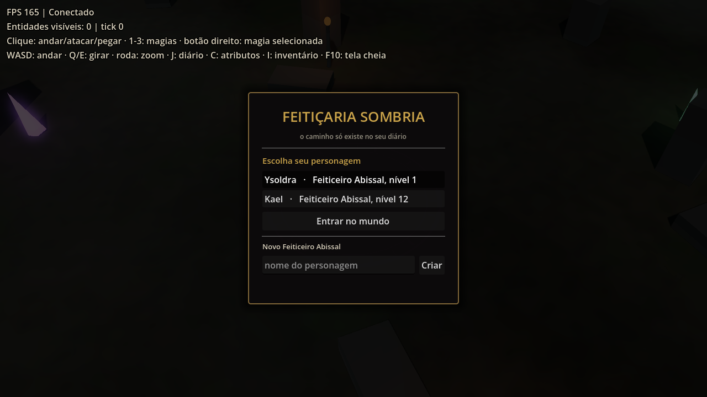

- **SQLite no servidor** com a extensão godot-sqlite v4.9 (MIT, SQLite 3.51). Só entram as bibliotecas de Windows e Linux, e a build Web não inclui a extensão (38,39 MB, como antes).
- **Camada de repositório** (`GameRepository`):
  - o jogo só troca Dictionaries com ela; `SqliteRepository` é a implementação atual;
  - tabelas: contas, personagens (com atributos), itens (incluindo o cofre) e diário por região;
  - trocar por PostgreSQL é escrever outra classe com os mesmos métodos.
- **Contas:**
  - senha com **PBKDF2-HMAC-SHA256**: sal aleatório e 600 mil iterações, calculado numa thread separada, sem travar o servidor;
  - 5 tentativas erradas derrubam a conexão;
  - quem fica parado na tela de login cai depois de 3 minutos;
  - se a mesma conta entra de novo, a sessão antiga é salva e derrubada com aviso.
- **Personagens:** até 5 por conta, com nomes únicos (sem diferenciar maiúsculas) que aceitam acentos.
- **O que é salvo:**
  - nível, XP, pontos, atributos, Óbolos, vida e mana, posição e magias aprendidas;
  - todos os itens (equipados, mochila e cofre), com o mesmo uid e a mesma posição na grade;
  - o diário, com traços, marcações e descobertas.
- **Quando salva:** ao sair, a cada 60 s (`server.json`) e quando a mesma conta entra em outro lugar. Itens que estavam na mesa da forja voltam para a mochila.
- **Tela de entrada:** login (entrar ou criar conta) e escolha ou criação de personagem por cima do mundo escurecido. O HUD e o diário só aparecem dentro do mundo. A última conta usada fica lembrada no cliente; a senha nunca é salva.
- **Nomes dos personagens** aparecem sobre os avatares, para todos.
- **Reconexão automática:** se a conexão cai, o cliente tenta de novo a cada 3 s e entra sozinho com o mesmo personagem. Se o motivo foi a conta ter entrado em outro lugar, ele volta para a tela de login, para as duas sessões não ficarem derrubando uma à outra.

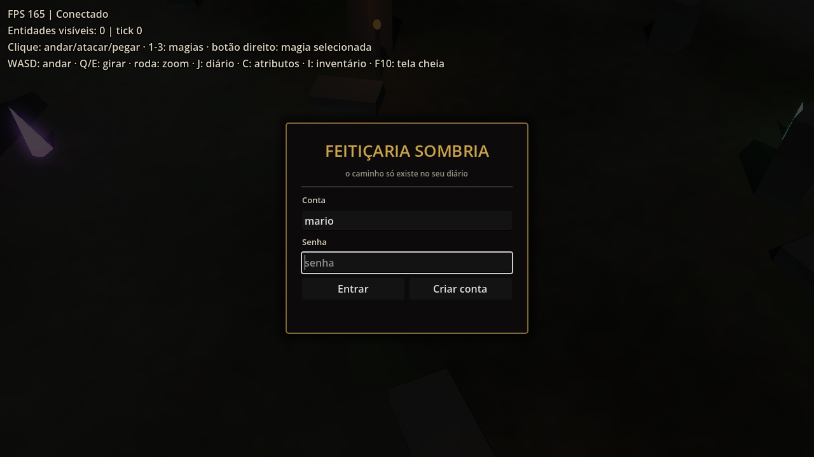
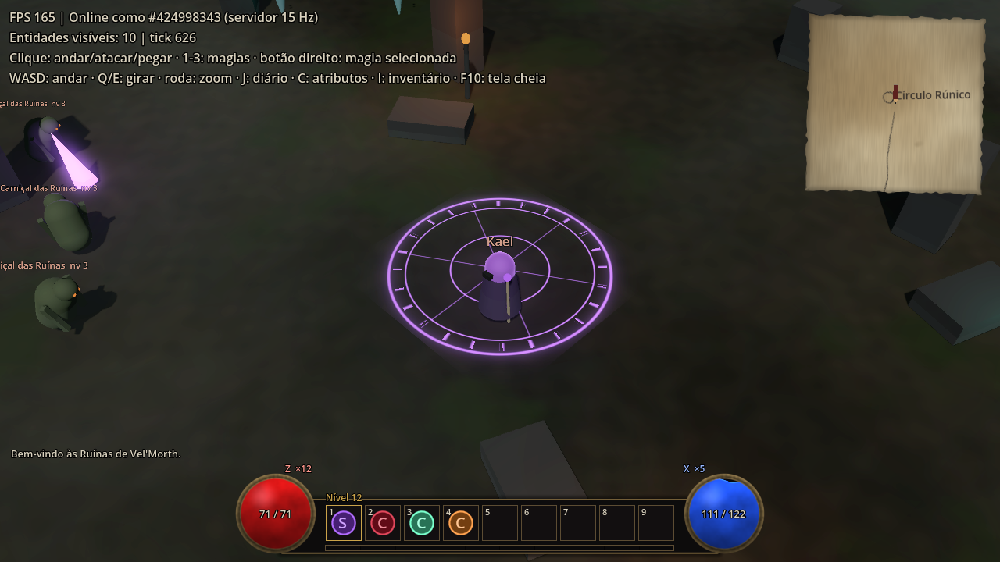

**Verificado:**
- **Testes:** 42 passam. Os 4 novos cobrem:
  - os vetores oficiais de PBKDF2-SHA256;
  - contas e personagens no SQLite em memória, ida e volta e regravação;
  - o diário serializado;
  - a reconstrução do personagem, inclusive a mesa da forja e itens com dados que não existem mais.
- **Persistência com o servidor reiniciado** (`--bot-persist=write`, servidor derrubado e iniciado de novo, depois `--bot-persist=check`): nível 12, 35 pontos, energia 50, 1234 Óbolos, magias, posição, 6 itens com os mesmos uids e posições (um no cofre em 3,4) e o diário com traço e 4 marcações voltaram iguais.
- **Multiplayer:** duas contas diferentes se enxergam; a mesma conta entrando duas vezes derruba a primeira; o roteiro da cidade continua passando com login.
- **Reconexão:** com o cliente gráfico no mundo, derrubei o servidor e subi de novo; o cliente reconectou e voltou ao mundo sozinho (captura `fase3_reconexao.png`).
- **Web:** a build tem 38,39 MB e mostra a tela de login sem erros no console.

**Ainda não verificado:** login pela Web numa aba visível e digitação de verdade nos campos (as capturas usam `--login-form`).

**Limitação conhecida:** se o processo do servidor for morto à força, perde-se até 60 s de progresso (o último salvamento automático). Um encerramento normal salva todos.

**Debug:** cliente com `--login=conta:senha:Personagem` (cria o que faltar), `--quick-login` ou `--login-form=conta:senha`; servidor com `--db=<arquivo>` ou `--db=:memory:`; bots com `--bot-account=`, `--bot-character=` e `--bot-persist=write|check`; `.\tools\run_local.ps1 -Quick -Gm`.

## Fase 2 — Itens e economia (concluída)

**Plano em 3 partes:** (1) itens, inventário em grade e equipamento visível; (2) joias, refino +0 a +15 e Forja do Vórtice (a "máquina de combinação" do prompt); (3) cidade com NPCs (ferreiro, mago, armazém), lojas e moeda.

### Parte 3: cidade, lojas, armazém e consumíveis — entregue
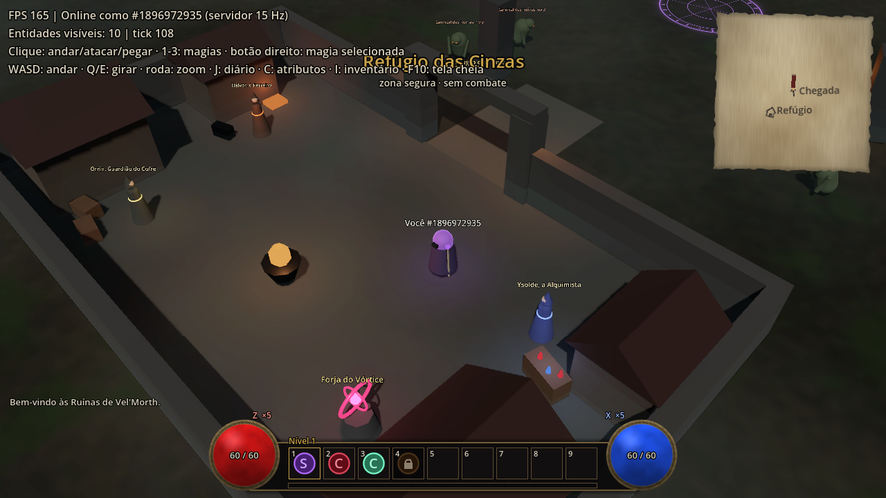

- **Refúgio das Cinzas:** cidade murada ao sul das ruínas, com portão, casas, braseiro central e a Forja do Vórtice (que saiu do campo). É o novo ponto de chegada e de renascimento.
- **Zona segura** (`safe_zones` em `data/regions/ruinas.json`):
  - monstros não miram, não perseguem e não atacam quem está dentro (desistem e voltam para casa);
  - não se lança magia dentro. Se você clicar num monstro lá fora, o personagem sai da cidade antes de atacar;
  - uma faixa no alto da tela avisa ao entrar e ao sair.
- **NPCs** com papéis vindos dos dados (`shop`, `storage`, `vortex_forge`). Clique no NPC: o personagem anda até ele e a janela abre ao lado do inventário. Afastar-se, Esc ou fechar o inventário fecham a janela.
  - **Hálvor, o Ferreiro:** cajados, broquel e o conjunto do Acólito.
  - **Ysolde, a Alquimista:** tônicos de vida (dois tamanhos), essência de mana, Pergaminho do Retorno e o Grimório da Chuva de Brasas.
  - **Orrin, Guardião do Cofre:** cofre de 8x10 por personagem.
- **Lojas** (`data/shops.json`, preços em `items.json`):
  - clique compra 1; Shift+clique compra 10 (empilháveis);
  - botão direito num item da mochila vende. Itens valiosos (raros, +7 ou acima de 150 Óbolos) pedem um segundo clique;
  - o valor de venda considera refino, raridade, sorte, opção extra e opções excelentes, e aparece no tooltip;
  - um teste garante que nenhuma loja paga mais do que cobra.
- **Cofre:** clique pega e solta entre o cofre e a mochila; botão direito guarda ou retira. Os itens ficam lá entre visitas, e o servidor recusa mexer neles com o cofre fechado.
- **Consumíveis empilháveis** (até 20 por pilha), com botão direito para usar:
  - tônicos e essência: **Z** usa o melhor tônico de vida que você pode usar e **X** a essência de mana; os contadores ficam ao lado dos orbes;
  - **Pergaminho do Retorno:** leva de volta à cidade, e o lápis do diário "levanta" no salto;
  - **Grimório:** ensina **Chuva de Brasas** (tecla 4, nível 8). Antes disso, o slot 4 aparece com cadeado.
- **Drops:** os monstros agora deixam cair tônicos, essências e pergaminhos.
- **Diário:** a cidade (símbolo de casinha), os NPCs e a forja viram marcações à mão.
- **Moeda:** as compras nas lojas e o custo da forja são os ralos de Óbolos.

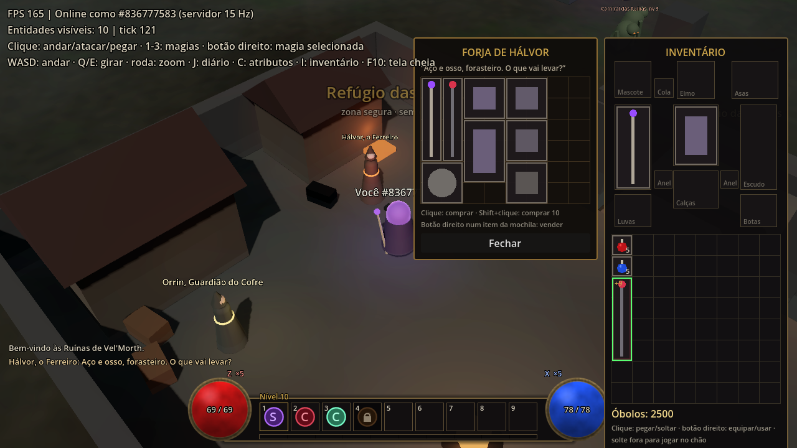
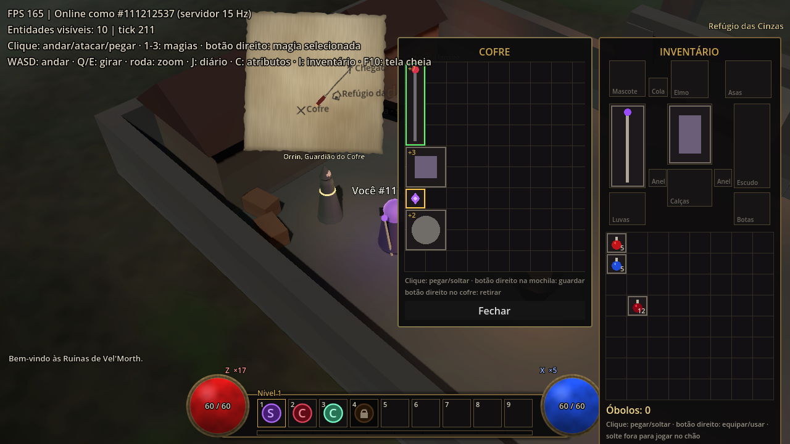
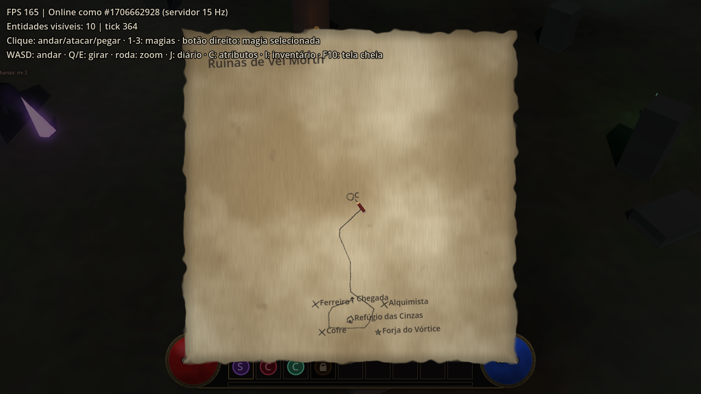

**Verificado:**
- **Testes:** 38 passam. Os 5 novos cobrem preços, pilhas e espaço, cofre, zona segura e as referências entre dados, cena e NPCs.
- **Bot `--bot-city`:**
  - nasceu na zona segura;
  - recebeu "magia não aprendida" e "não se luta no Refúgio";
  - comprou 10 tônicos (empilhados com os 5 iniciais), o grimório e um pergaminho;
  - aprendeu a magia (máscara 15 → 31);
  - teve a poção recusada com a vida cheia;
  - vendeu a vara +9 excelente pelo preço exato da prévia (18 089);
  - guardou e retirou itens do cofre, e o cofre fechado recusou a retirada;
  - abriu a forja na cidade, saiu pelo portão e voltou com o pergaminho.
- **Bot de combate:** 7 abates, nenhuma morte, saindo da cidade.
- **Cliente gráfico:** capturas da cidade, das lojas, do cofre e do diário.
- **Web:** a build tem 38,35 MB e carrega sem erros no console.

**Ainda não verificado:** o fluxo com o mouse de verdade (as capturas usam roteiros de debug) e o jogo na Web com a aba visível.

**Debug:** `--bot-city` (bot) e `--open-npc=<id>` com `--store-demo` (cliente). O comando de GM `item` aceita a quantidade como 7º argumento.

### Parte 1: itens, inventário e equipamento — entregue
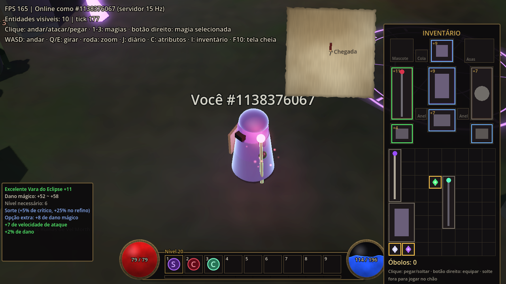

- **Itens de verdade** (`data/items.json`): 3 cajados, broquel, conjunto do Acólito (capuz, manto, calças, luvas, botas), amuleto, anel e as 5 joias com nomes originais (Lágrima Consagrada, Fragmento de Alma, Gema do Vórtice, Seiva Vital, Pedra da Gênese).
- **Atributos de item:** nível +0 a +15 (bônus por nível em `item_options.json`), Sorte (+5% de crítico), opção extra (+4 por nível) e raridades:
  - *Normal*;
  - *Excelente*: 1–2 opções especiais (dano excelente, +dano %, velocidade, vida/mana ao matar, +vida %, +mana %, redução de dano, reflexo, +Óbolos);
  - *Ancestral*: +10 num atributo e **bônus de conjunto** com 2, 3, 4 e 5 peças (`sets.json`).
- **Drops** sorteiam nível, sorte, opção extra e raridade (`drops.json -> item_rolls`); o nome no chão tem a cor da raridade (ancestral em azul).
- **Inventário em grade 8x8** (I ou V): cada item ocupa o seu tamanho; clique pega, clique solta (com prévia verde/vermelha); botão direito equipa/desequipa; soltar fora da janela joga no chão. Tooltip com atributos, requisitos e opções.
- **Equipamento em "boneco"** com 12 slots. O servidor valida slot, nível exigido e espaço (inclusive nas trocas).
- **Os bônus valem de verdade:** dano mágico, defesa, vida/mana (inclusive %), crítico, dano excelente, +dano %, redução, reflexo, vida/mana ao matar e +Óbolos entram nas fórmulas e no combate.
- **Equipamento visível no personagem** (cajado, escudo, capuz, manto, calças, luvas, botas) e replicado para os outros jogadores. **Brilho progressivo:** contorno a partir de +7, mais forte a partir de +9 e aura de partículas a partir de +11; excelente e ancestral ganham contorno verde e azul.
- **Comandos de GM** (servidor com `--allow-gm`): `item <base> [nível] [raridade] [sorte] [extra]`, `level <n>`, `currency <n>`.

**Verificado:** 27 testes (grade, codec, refino/opções, conjuntos, dados). Bot: coletou itens para a grade, equipou o capuz (defesa de 15 para 21) e moveu moeda. Cliente gráfico com itens de GM: todos os slots equipados, mana de 158 para 196 com o bônus ancestral, tooltip conferido por captura. Build Web (38,3 MB) carrega sem erros.

**Ainda não verificado:** arrastar e soltar com o mouse de verdade (as capturas usam comandos de debug), e qualquer coisa na Web com a aba visível.

**Debug:** `godot --headless --path . -- --server --allow-gm` + `godot --path . -- "--gm=level 20;item vara_eclipse 11 1 1 2" --auto-equip-all --open-inventory`.

### Parte 2: joias, refino e Forja do Vórtice — entregue
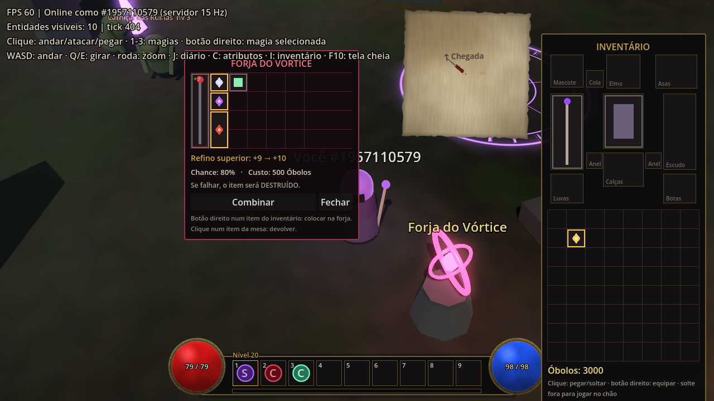

- **Joia sobre item** (clique na joia, depois no item), regras em `data/refine.json`:
  - *Lágrima Consagrada*: +1 até +6, sempre funciona;
  - *Fragmento de Alma*: +1 até +9 com 55% (80% com Sorte); na falha, de +0 a +6 perde 1 nível e em +7/+8 volta a +0;
  - *Seiva Vital*: +1 na opção extra com 50%; na falha, zera a opção extra.
  - A joia é consumida na tentativa; o resultado e o efeito vêm do servidor.
- **Forja do Vórtice** (artefato arcano no mapa, perto da chegada): clique para andar até ela; a janela abre junto com o inventário. Botão direito num item da mochila coloca na mesa; clique num item da mesa devolve. Afastar-se fecha a forja e devolve tudo.
  - *Refino superior* (+9 → +15): 1 equipamento + joias exatas por nível + Gema do Vórtice (+ Pedra da Gênese a partir de +12) + Óbolos. Chance de 60% a 50%, +10% com Sorte, −10% em Excelente/Ancestral, +10% por Talismã da Fortuna (até 3), teto de 90%. **Na falha o item é destruído**, a menos que haja um Selo de Preservação.
  - *Receitas:* Talismã da Fortuna, Selo de Preservação e Seiva Vital (`data/recipes.json`).
  - A janela mostra a receita reconhecida, a chance, o custo, o risco e o que falta.
- **Feedback dramático:** sucesso = explosão dourada, flash e "+N!" grande; falha = cinzas caindo e "Falhou"; destruído = nuvem escura maior e "Destruído!". Os outros jogadores também veem.

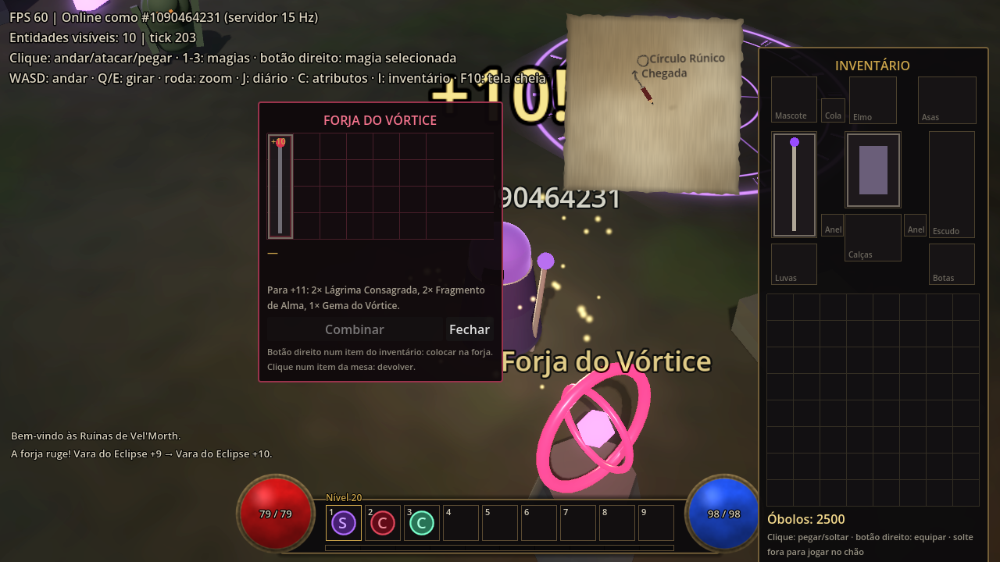

**Verificado:** 33 testes, incluindo **simulação estatística** (20 mil tentativas: a taxa da Alma fica em ±1,5% de 55%/80%), regras de falha, opção extra e receitas da forja (chances, talismãs, selo, penalidade de raridade, ingredientes exatos). Bot: Bênção +0→+1, Almas com sucesso e falha rebaixando, forja com prévia "90%, protegido", falha preservada pelo selo. Cliente gráfico: janela da forja e refino +9→+10 com sucesso e efeito (capturas). Build Web (38,3 MB) carrega sem erros.

**Ainda não verificado:** o fluxo com o mouse de verdade (as capturas usam roteiros de debug), e na Web com a aba visível.

**Observação de desempenho:** as capturas mais recentes mostram 60 FPS porque o vsync segue a tela de 60 Hz; sem vsync, a mesma cena roda a 623 FPS.

## Fase 1 — Protótipo single-player do núcleo (em andamento)

### Parte 1: mapa-diário a lápis — entregue
- Andar desenha a linha em tempo real: a ponta do lápis avança e acelera se ficar para trás.
- Traço de grafite com pressão, tremor e ondulação; o grão do papel "segura" o grafite; passagens repetidas escurecem.
- Papel envelhecido procedural (manchas, fibras, pintas, vinheta, bordas rasgadas).
- Marcos descobertos por proximidade: símbolo traçado traço a traço (X, círculo, estrela, seta, hachura) e nome escrito letra por letra. Rótulos que se sobrepõem descem uma linha.
- Minimapa no canto superior direito (segue o jogador, norte fixo) e diário em tela cheia com **J** (Esc fecha; o personagem não se move com ele aberto).
- O lápis vermelho marca a posição e a direção do jogador.

**Critérios de aceite (seção 5.4):**
| Critério | Situação |
|---|---|
| Andar desenha a linha em tempo real com aparência de lápis | ok no desktop; na Web, só o papel foi visto renderizando |
| Nada de terreno não visitado na interface | ok: não existe outra fonte de informação espacial |
| Pontos de interesse anotados com animação de escrita | ok |
| Persiste entre sessões, por personagem | **Fase 3** (hoje fica em memória por conexão) |
| Desempenho estável após horas de caminhada | ok: custo constante no cliente; 5 h simuladas no servidor viram 17 mil pontos em 80 ms |

**Testar:** `.\tools\run_local.ps1`, andar pelas ruínas e passar perto dos cristais, das tochas, do círculo e do pilar ao leste. Abrir o diário com J.
**Debug:** `godot --path . -- --autowalk="-3,3;-9,5;0,0" --open-journal` anda sozinho por esses pontos.

### Parte 2: combate, monstros, progressão e HUD — entregue
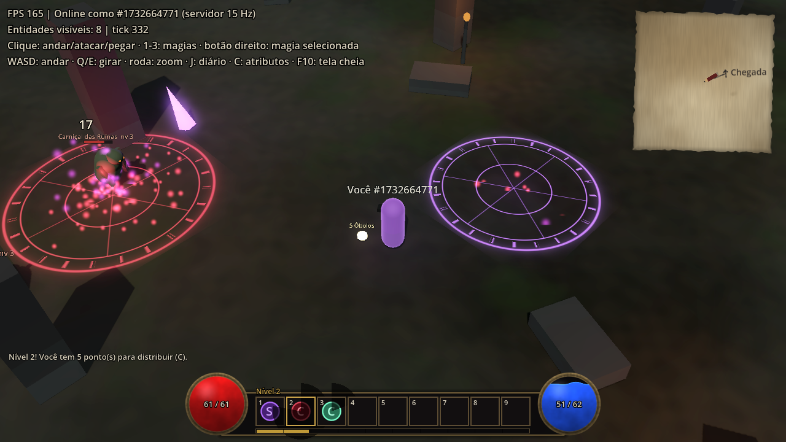

- **Movimento:** pathfinding no servidor (A* numa grade de 0,5 m + suavização por linha de visão), montado a partir dos obstáculos da **mesma cena** que o cliente renderiza. WASD desliza nas paredes. O clique no chão mostra uma runa dourada.
- **Feiticeiro Abissal** com ataque básico e 3 magias (`data/spells.json`):
  - *Toque Sombrio* (clique no monstro): projétil fraco, ataque contínuo.
  - *1 · Seta Abissal*: projétil violeta com rastro, luz e impacto.
  - *2 · Círculo de Chamas Negras*: círculo rúnico carmesim cresce no chão (antecipação de 0,7 s) e então entra em erupção (partículas, flash, tremida de câmera).
  - *3 · Corrente do Véu*: raio verde-espectral que salta para até 3 monstros próximos, com dano decrescente.
  - Fora de alcance, o personagem anda até o alvo e então conjura (como no MU). Recarga e mana são validadas no servidor.
- **2 monstros** (`data/monsters.json`): Carniçal das Ruínas (lento, corpo a corpo) e Espectro Sussurrante (rápido, flutua). IA: vagar → perseguir → atacar → voltar para casa (coleira), com respawn por tempo.
- **Combate:** dano normal, crítico (azul, dano máximo) e excelente (verde, máximo × 1,2), com números flutuantes; dano recebido em vermelho. Tudo calculado no servidor.
- **Drops** (`data/drops.json`): Óbolos (moeda), itens Normais e Excelentes e joias, com nome colorido por raridade e posse de 10 s para quem matou. Clique para pegar.
- **XP e nível:** tabela exponencial; 5 pontos por nível, distribuídos na janela de atributos (C; Shift+clique soma 5). As fórmulas dos atributos derivados ficam em `data/classes/feiticeiro.json`.
- **Morte:** o personagem renasce em 4 s e o local vira uma cruz "Aqui caí" no diário.
- **HUD:** orbes de vida e mana (shader de líquido) colados à barra de skills 1–9 (recarga em "pizza", aviso de falta de mana), barra de XP, quadro do alvo no topo e log de mensagens.

**Verificado:** bot de combate (45 s): 6 monstros mortos, nível 3, 4 drops, dano dado e recebido. Cliente gráfico lutando sozinho: magias, números, drops e HUD conferidos por captura de tela. Build Web gerada (38,2 MB); HUD e shaders carregam no WebGL 2 sem erros no console. 20 testes automatizados passando.

**Ainda não verificado:** combate com a aba do navegador visível (pelo mesmo motivo da parte 1). FPS na Web com combate.

**Debug:** `godot --path . -- --autofight` luta sozinho; `--open-stats` abre os atributos; `godot --headless --path . -- --bot --bot-fight` é um bot de combate sem gráficos.

**Problema a investigar:** uma aba que carrega o jogo **em segundo plano** (o navegador limita a cerca de 1 FPS) não conseguiu conectar. Com a aba visível, conecta normalmente. O prompt pede para tratar a perda de foco; vou atacar isso na Fase 3 (reconexão automática).

## Fase 0 — Fundação (concluída em 2026-11-12)

Aceite: o usuário testou duas abas no Chrome e no Firefox e cada uma viu a outra andar. O FPS por navegador não foi registrado; medir de novo no início da Fase 1, já com mais conteúdo na tela.

### Feito e verificado
- Projeto Godot 4.7.2 com renderer **Compatibility**, estrutura de pastas e documentos iniciais.
- Cena de teste: câmera isométrica a 45°, lua com sombra, tochas tremulando, cristais emissivos, círculo rúnico animado, névoa do `Environment` e três camadas de névoa falsa. Renderizada no desktop (Compatibility, OpenGL 3.3) **sem erros de shader**.
- Prova de conceito de rede: servidor headless e clientes via **WebSocket**. Teste: servidor, 2 bots e 1 cliente gráfico. Todos receberam cerca de 15 snapshots/s e cada um enxergou os outros dois andando (logs do servidor e dos bots).
- 6 testes automatizados passando (`.\tools\run_tests.ps1`).
- Preset de exportação Web (single-thread), scripts de build, medição de tamanho e servidor local.

- Export templates 4.7.2 instalados (SHA-512 conferido com o oficial) e **build Web gerada**.
- No navegador embutido do app (Chromium, WebGL 2): a build carrega, o renderer Compatibility sobe ("OpenGL ES 3.0 / WebGL 2.0, single-threaded") e **névoa, glow e círculo rúnico aparecem iguais ao desktop**. O cliente Web **conectou ao servidor headless e entrou no jogo** (log do servidor).
- Bug encontrado e corrigido na Web: a primeira conexão caía no timeout de handshake de 3 s da Godot, porque a página trava enquanto compila os shaders. Agora o timeout é de 15 s e o cliente espera 10 frames antes de conectar (`network.json`).

### Medições
| Item | Valor | Observação |
|---|---|---|
| FPS desktop | 165 (limite do monitor) | RTX 4050 Laptop, 1280×720, 3 jogadores |
| FPS Web | 78 (uma medição) | navegador embutido, 800×600; **repetir no Chrome e no Firefox com a janela visível** |
| Build Web (sem compressão) | **38,1 MB** (wasm 37,7 MB, pck 0,06 MB) | no limite da meta de 30–40 MB |
| Build Web (wasm com gzip) | **cerca de 9,7 MB** transferidos | o servidor de produção deve servir com gzip/brotli |

### Pendência herdada
- Medir o FPS no Chrome e no Firefox (janela visível), num notebook com GPU integrada, que é o alvo da especificação.

### Problemas conhecidos
- Quando dois clientes fecham no mesmo instante, o servidor registra uma vez `ERROR: Condition "ready_state != STATE_OPEN"` (vem do próprio WebSocket da Godot, ao avisar a saída de um peer para outro que também está saindo). Não tem efeito no jogo.
- O som ainda não existe. A tela "Clique para entrar", que libera o áudio na Web, vem junto com o login.
