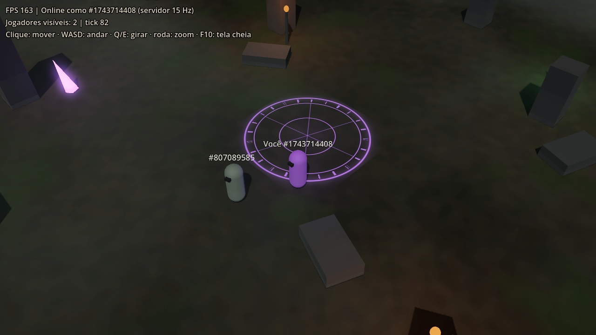

# Guia de arte (contrato visual)

As referências são 4 imagens enviadas em 2026-11-12. Os arquivos devem ficar em `docs/referencias/` com os nomes `ref_01.png` a `ref_04.png` (as imagens vieram pelo chat e precisam ser salvas lá manualmente).

As referências servem **só como estilo e mecânica**: não copiamos modelos, texturas, nomes, logos nem o layout exato da interface.

---

## Análise das referências

### ref_01 — Combate em campo aberto (clássico, cerca de 2003)
- **Câmera:** perspectiva com inclinação de cerca de 45 a 50°, enquadramento médio (personagem com cerca de 1/8 da altura da tela). Nada de ortográfica pura.
- **Paleta:** mundo terroso e fosco (verde-oliva, marrom de terra batida, troncos cinza); a única cor saturada é a **explosão de fogo** (amarelo, laranja e branco aditivos).
- **Iluminação:** luz direcional forte com **sombra projetada longa e nítida** (o personagem à direita). Leitura de silhueta excelente.
- **VFX:** um feitiço de impacto cobre cerca de 3 vezes o corpo do personagem e tem núcleo branco "estourado". A magia domina o quadro.
- **UI:** barra inferior em toda a largura; atalhos QWER à esquerda, consumíveis com contadores, medidores verticais de vida e mana, slots 1 a 5 de skills e ícones de sistema à direita. Mapa e coordenadas no canto superior esquerdo. Log de sistema em azul no canto inferior esquerdo. **Aviso de evento centralizado** ("faltam 5 minutos para..."). Nome do monstro-alvo em vermelho no topo central.

### ref_02 — Praça de cidade
- **Câmera:** mais inclinada (cerca de 55 a 60°) e mais próxima: a cidade usa zoom maior que o campo.
- **Materiais:** piso de lajotas de pedra com rejunte, canteiros com vegetação, estátua de dragão numa fonte. Texturas com **muito detalhe por tiling** sobre geometria simples (low-poly).
- **Personagem:** **asas translúcidas iridescentes** (ciano e verde, aditivas, com alfa suave), arma com brilho avermelhado. Dá para ler o equipamento a distância.
- **Marcador:** losango ou quadrado branco no chão sob o personagem (destino do clique ou tile selecionado).
- **Luz:** quente, com faixas de sombra suaves de prédios fora da tela.

### ref_03 — Versão moderna (cerca de 2020)
- Mesma câmera e mesmos sistemas, mas com **bloom forte**: asas azuis que viram fonte de luz, com partículas.
- Calçamento de pedra, grama e sombras manchadas de árvores.
- **HUD compacto e centralizado:** orbe vermelho de vida e orbe azul de mana nas pontas da barra de skills, e não nas laterais da tela.
- Lição: a mesma base low-poly ganha muito só com **emissão, bloom e partículas** — exatamente o que dá para fazer no Compatibility.

### ref_04 — Seleção de personagem (conceito de UI)
- Fundo quase preto com **fumaça e névoa** e **brasas** vermelhas e laranja subindo.
- Tipografia: **maiúsculas com espaçamento largo**, títulos em dourado ou laranja e textos em off-white; linhas finas de moldura, ícones em **losango**.
- Layout: atributos em caixas à esquerda, personagem grande no centro, nome da classe embaixo com setas ‹ ›, e botão "Confirmar" no canto inferior direito.
- **Cada classe tinge o fundo com a sua cor de magia** (o mago fica azul e espectral). Vamos adotar isso: cada classe tem uma cor de assinatura.

---

## Diretrizes derivadas (contrato)

### Câmera
- Campo: inclinação de **45°** e yaw inicial de 45°, FOV de 40°, distância de 18 m (zoom entre 11 e 26 m).
- **Cidade: inclinação de 55° e zoom mais próximo** (perfil por região, Fase 4).
- Valores em `data/config/camera.json`.

### Leitura acima de tudo
- O chão **sempre** mostra textura e variação; nunca vira um borrão escuro. O tom sombrio vem da **paleta e da névoa**, não de falta de luz.
- Sombra direcional nítida e bem visível (a silhueta do personagem é parte da leitura).
- O personagem precisa se destacar do chão: contorno (rim/fresnel) e valor mais claro que o fundo.

### Paleta
| Papel | Cores | Uso |
|---|---|---|
| Mundo (fosco e terroso) | terra `#382F26`, pedra `#29292B`, musgo `#212B14`, céu `#08090D` | chão, ruínas e céu |
| Luz ambiente | cinza-azulado `#5C616B` | preenchimento das sombras |
| Sol/lua | branco-envelhecido `#C7C2B3` | luz direcional, a única com sombra |
| **Magia (principal fonte de cor)** | violeta `#9E47FF`, verde-espectral `#59FF8C`, carmesim `#D11A33`, azul-gelo `#5AB4FF`, dourado arcano `#E0B040` | feitiços, asas, cristais, runas e auras |
| Fogo | laranja `#FF8C38`, núcleo `#FFF2C0` | tochas e magias de fogo |
| UI | dourado `#C9A24A`, laranja `#E07A2E`, off-white `#D9D1BD`, preto `#0B0B0D` | textos, molduras e destaques |

Regra: **nada no mundo é saturado, exceto magia, fogo e equipamento refinado.**

Cor de assinatura por classe: Feiticeiro Abissal **violeta**; Cavaleiro Profano **carmesim**; Vidente do Véu **verde-espectral**.

### Iluminação (orçamento para WebGL 2)
- Uma luz direcional com sombra. Luzes pontuais **sem sombra**, no máximo cerca de 8 visíveis por área (a calibrar na Web).
- Glow com limiar de 0,9: só emissivos brilham (magia, fogo, asas, itens refinados).

### Névoa
- Névoa do `Environment` leve (densidade de 0,012) e três planos de névoa falsa rente ao chão (0,25, 0,8 e 1,6 m) que não escondem os personagens.

### Magia e VFX
- Antecipação: **círculo rúnico no chão** (quad com shader, [rune_circle.gdshader](../assets/shaders/rune_circle.gdshader)), nunca decal.
- Impacto: núcleo branco aditivo, explosão de cerca de 3 vezes o tamanho do corpo, leve tremida de câmera e flash (ref_01).
- Biblioteca de shaders (Fase 1): dissolve, fresnel/rim, distorção, runas animadas e asas translúcidas.

### Asas (Fase 4)
- Planos translúcidos com gradiente iridescente, blend aditivo e animação de bater. Os tiers mais altos ganham partículas e emissão forte (ref_02 → ref_03).

### HUD (Fase 1)
- Barra inferior compacta e **centralizada**, com **orbe de vida (carmesim) à esquerda e orbe de mana (azul) à direita** da barra de skills 1 a 9 (ref_03), e barra de XP embaixo.
- Nome da região no canto superior esquerdo, **sem coordenadas e sem minimapa** (a referência espacial é só o mapa-diário).
- Log de sistema no canto inferior esquerdo; avisos de evento centralizados; nome do alvo no topo.
- Marcador de destino do clique no chão (ref_02), num estilo nosso: uma pequena runa que some com o tempo.
- Estilo: metal escuro, pergaminho, maiúsculas espaçadas e serifadas, ícones em losango (ref_04).

### Telas de menu (login e seleção de personagem)
- Seguir a ref_04: fundo escuro com fumaça animada e brasas (CPUParticles2D), personagem no centro e a tela tingida com a cor da classe.

---

## Estado atual (Fase 0)

Ajuste feito depois das referências: a luz direcional e a ambiente ficaram mais fortes, e o chão ganhou valores mais claros, para que textura e sombra apareçam como nas referências.
