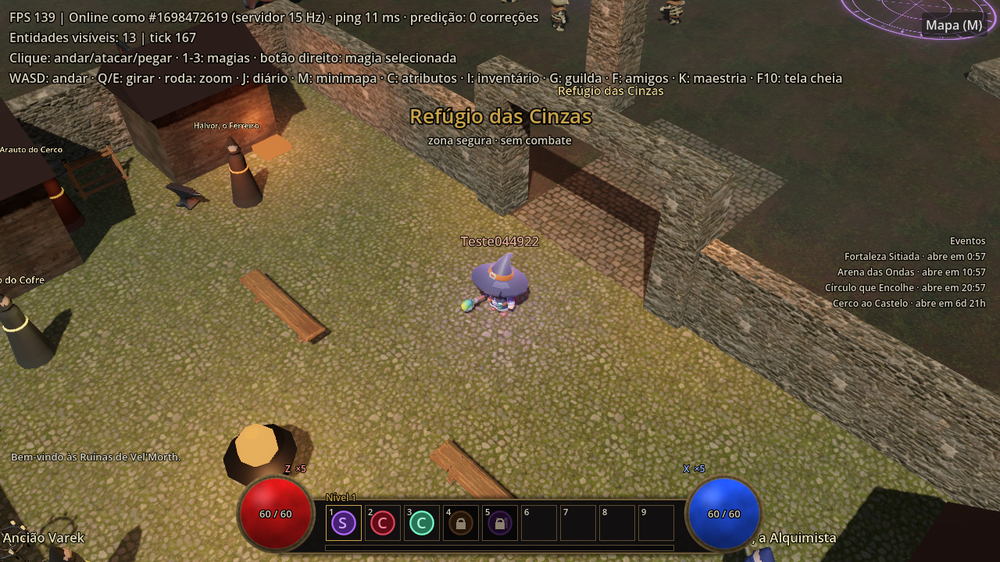
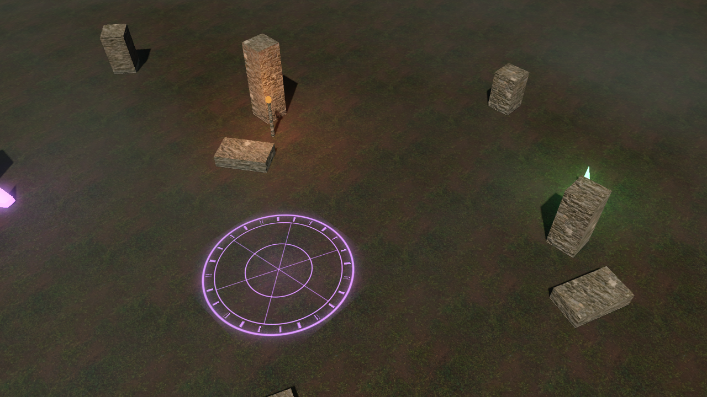
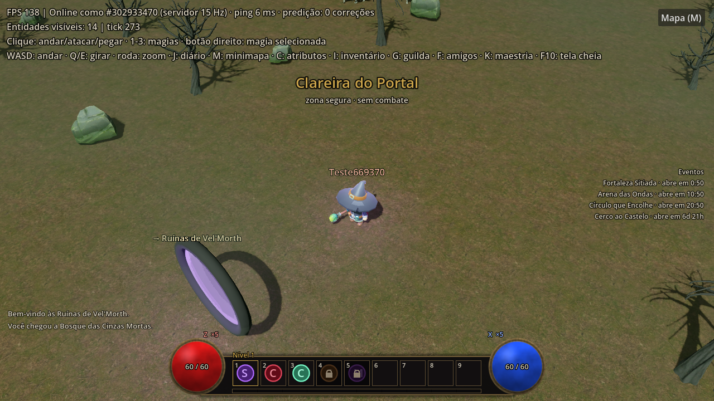
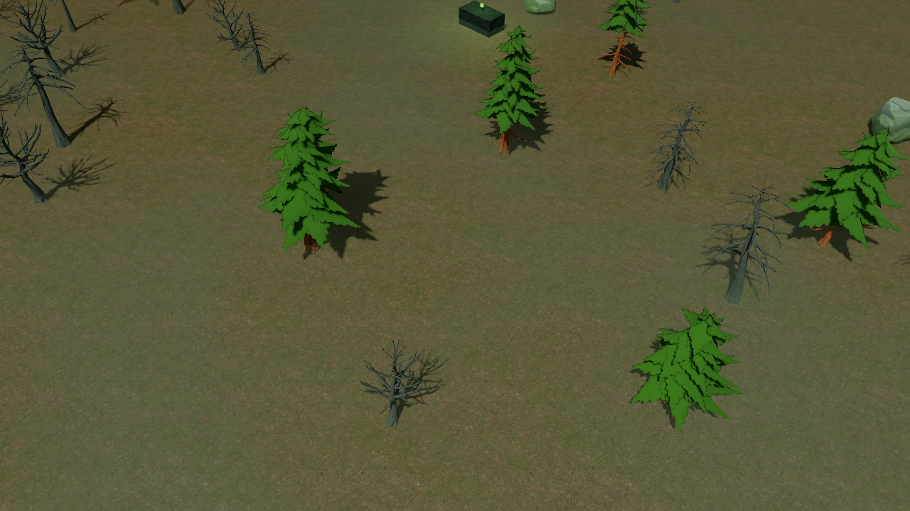
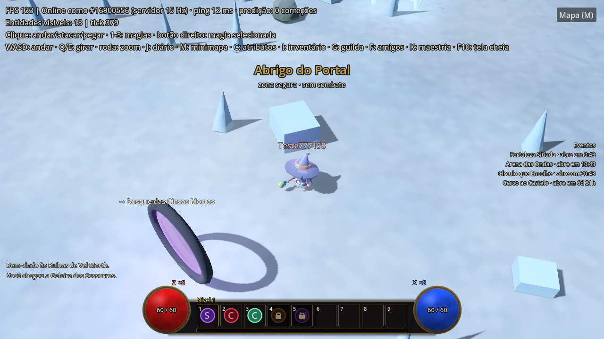
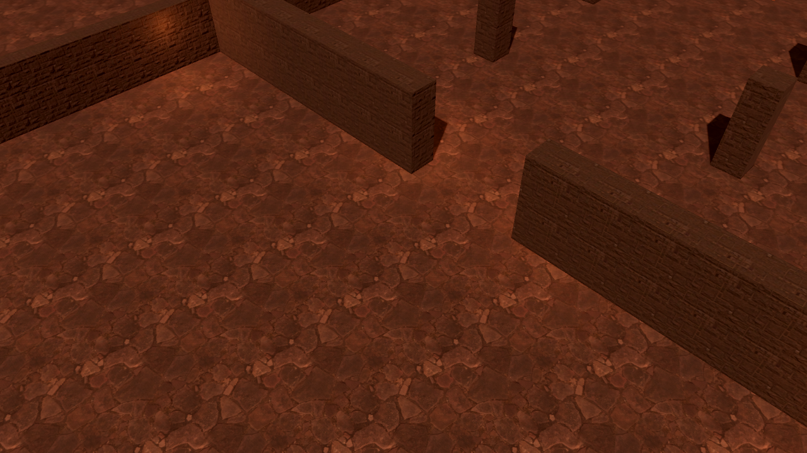
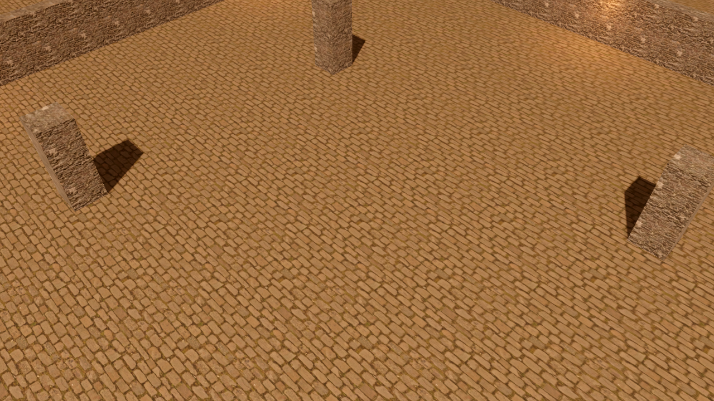
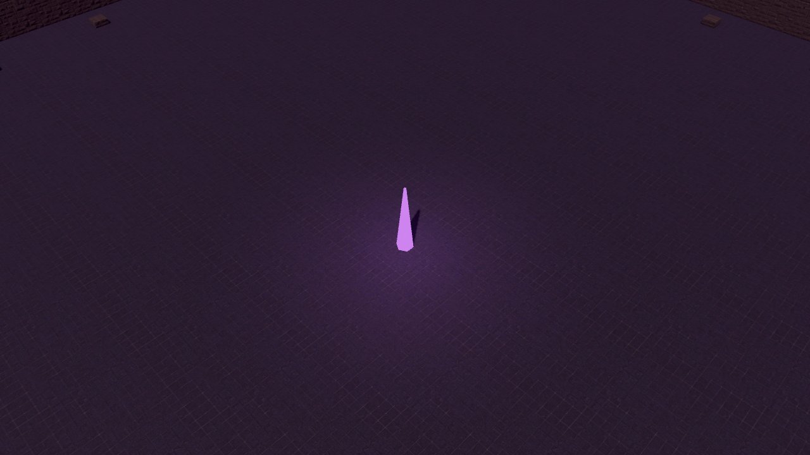
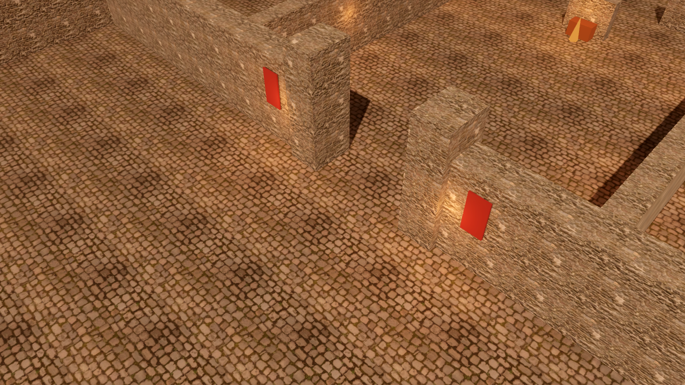
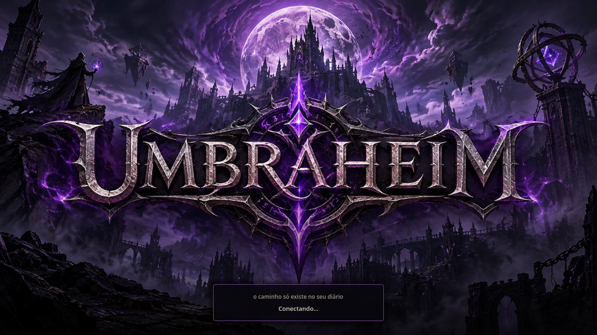

# Proposta de ambientação do mundo — Umbraheim

> **Status: PROPOSTA, aguardando aprovação.** Nada foi implementado. Este documento cobre só o **mundo** (luz, névoa, céu, pós-processamento, paleta por região, partículas de ambiente, densidade e composição do cenário) e a **tela de entrada como cena** (fundo, fumaça, brasas e luz). Menus e HUD ficam com o outro agente.
>
> Base: [GUIA_DE_ARTE.md](../GUIA_DE_ARTE.md) (contrato visual), [FASES.md](../FASES.md) (assets já aplicados) e as cenas atuais. O MU Online é só referência de estilo: nomes, cores e composições daqui são nossos.

Imagens em [`img/ambientacao/`](img/ambientacao/). Há dois tipos:
- `diag_<região>.png`: o jogo de verdade (cliente + servidor, `--gm=goto`), câmera padrão de 18 m, com o HUD;
- `diag_<região>_centro.png`: só a cena da região, sem HUD e sem personagens, com a mesma câmera (45°, FOV 40°) a 22 a 24 m do centro. Foi o jeito de ver as regiões de evento (Fortaleza, Arena, Círculo e Castelo), que o `goto` não abre porque são instâncias.

---

## 1. Diagnóstico

### 1.1 O que vale para todas as regiões

1. **O céu quase nunca aparece.** Com 45° de inclinação e FOV de 40°, a parte de cima da tela ainda é chão. Mesmo no zoom máximo (26 m) não se vê o horizonte. Por isso o "céu" de cada região é, na prática, **a cor da névoa e da luz**. Mexer no `ProceduralSkyMaterial` muda pouco; o investimento tem que ir para névoa, luz e partículas perto do chão.
2. **Tudo parece meio-dia nublado.** O sol está alto, a luz ambiente é uniforme (`ambient_light_source = Color`) e a névoa de 0,012 é fraca demais na distância da câmera (18 a 26 m): ela tira só cerca de 20% do contraste. O resultado é um mundo claro e chapado, sem profundidade. O contrato pede "o tom sombrio vem da paleta e da névoa", e hoje a névoa quase não trabalha.
3. **As regiões não têm uma cor de assinatura no ar.** A cor própria de cada região está só no chão, não na luz, na névoa nem nas partículas. Fortaleza, Arena e Castelo ficam com o mesmo laranja-marrom.
4. **Nenhuma partícula de ambiente.** Não há cinza, neve, brasas, poeira nem vaga-lumes. Todo o movimento vem de personagens e magias. Um mundo parado parece maquete.
5. **Chão plano e repetitivo.** Um plano só com uma textura em tiling: a repetição aparece muito na Arena e no Castelo. Faltam variação em escala grande (manchas, terra, musgo) e detalhes pequenos (pedrinhas, tufos, entulho).
6. **Bordas sem moldura.** As regiões acabam num muro ou no nada. Falta um anel de silhuetas (penhascos, árvores e ruínas fora da área jogável) que feche o quadro e esconda o limite.
7. **Pós-processamento quase igual em todas as cenas:** Filmic, glow 0,7 a 0,8 com limiar 0,9, saturação 0,8. Não há vinheta. A névoa falsa em camadas (`fake_fog.gdshader`) só existe em 3 das 7 cenas.
8. **Para modelos realistas, a luz atual não ajuda.** A ambiente chapada achata volumes, e não há luz de recorte (rim) nem sombra de contato. Os modelos chibi aguentam isso; um modelo realista vai parecer "colado" no chão.

### 1.2 Região por região

| Região | Imagem | O que está acontecendo |
|---|---|---|
| **Ruínas de Vel'Morth** (Refúgio) |  | O Refúgio está bem legível, mas tem a luz de uma praça ao meio-dia: grama verde-oliva saturada, sem a poça quente das tochas. O caldeirão e as tochas viram discos laranja chapados (emissão sem luz em volta). Os muros não têm acabamento no topo. Falta o contraste **quente dentro / frio fora** que daria a sensação de abrigo. |
| **Ruínas** (campo) |  | O círculo rúnico e os cristais funcionam muito bem: são os únicos pontos de cor, como pede o contrato. O resto é um chão marrom-esverdeado uniforme com pilares que são caixas. Está vazio: não há entulho, pedrinhas, colunas tombadas nem mato seco. A névoa aparece só no canto superior direito. |
| **Bosque das Cinzas Mortas** |   | **O nome promete cinza e a cena entrega verde.** Os pinheiros da Stylized Nature são verde-vivo saturados (quebram a regra "nada saturado no mundo"), e as pedras ficaram verde-menta. O chão é um gramado uniforme. As árvores mortas estão ótimas (silhueta forte, sombra longa), mas espalhadas demais: não formam mata. |
| **Geleira dos Sussurros** |  | **Superexposta.** O chão é quase branco, as sombras são a única informação e o personagem não se destaca (o contrato pede o personagem mais claro que o fundo, e aqui é o contrário). O gelo são primitivas lisas azul-claras sem textura nem brilho. Lê como "neve ao meio-dia", não como uma geleira assombrada. |
| **Fortaleza Sitiada** |  | **Monocromática:** chão, muros, luz e névoa no mesmo laranja-ferrugem. Não há separação de valor entre o muro e o chão. Um cerco pede fumaça, fogo e brasas, e não tem nenhum. |
| **Arena das Ondas** |  | Calçamento laranja saturado sob uma luz quente uniforme: parece uma praça ensolarada. O tiling do calçamento é muito visível. Sem drama nenhum para um evento de ondas de monstros. |
| **Círculo que Encolhe** |  | **O chão não lê.** É roxo-escuro quase liso; só o obelisco aparece. Quebra a regra "o chão sempre mostra textura e variação". A ideia (vazio violeta) é boa, mas falta valor no chão e falta a parede do círculo como fonte de luz. |
| **Castelo das Brasas** |  | A melhor das regiões de evento: as tochas fazem poças de luz e o calçamento lê. Problemas: a textura do muro tem **pontinhos brancos** que piscam (realce especular ou mapa de rugosidade), os estandartes vermelhos são planos chapados sem sombreamento, o tiling do chão se repete muito, e a cor está saturada demais para "brasas". |

**Tela de entrada:**

A arte-título é forte (lua violeta, castelo, runas), mas é uma **imagem parada**: nada se mexe. A ref_04 pede fumaça e brasas subindo, e a cena tem tudo para isso (a névoa na base e a lua já estão desenhadas).

---

## 2. Direção visual geral

**"Lanterna no escuro."** O mundo é fosco, frio e úmido; a luz quente (fogo) e a luz mágica (cor de assinatura) são raras e por isso valem muito. Três camadas de leitura, nesta ordem:

1. **Silhueta e sombra** (sol/lua baixo, sombra longa e nítida): é a leitura principal, como na ref_01.
2. **Valor** (claro e escuro): o chão em valor médio-baixo (nunca preto), o personagem mais claro e com recorte, e o fundo some na névoa.
3. **Cor**, só em três lugares: a **assinatura da região** (no ar: névoa, partículas, cristais), o **fogo** (tochas e braseiros, sempre com poça de luz no chão) e a **magia e o equipamento** (o que o jogador traz).

Regras práticas:
- **Sol baixo** (elevação de 30 a 40°) em todas as regiões, para sombras longas. A direção muda por região, para que cada uma tenha um "lado iluminado" próprio.
- **Névoa mais forte e colorida** (densidade de 0,02 a 0,03), com a cor da assinatura escurecida. É ela que dá profundidade e esconde a borda do mapa.
- **Contraste de temperatura:** ambiente frio (azul, cinza ou violeta) contra fontes quentes (fogo). As zonas seguras são **bolsões quentes**; o campo é frio.
- **Movimento no ar:** toda região tem pelo menos uma partícula de ambiente, discreta (de 40 a 120 partículas na tela).
- **Moldura:** um anel de silhuetas escuras fora da área jogável em toda região aberta.
- **Saturação baixa no mundo e alta na magia.** As texturas e os modelos de natureza são retingidos para baixo; a magia continua estourando no glow.

### Suporte aos modelos realistas (Quaternius)

Sem escolher modelos, a luz e os materiais devem se preparar para eles:
- **Ambiente com direção:** trocar a ambiente chapada por um "hemisfério falso": a ambiente atual mais uma **luz de preenchimento** direcional **sem sombra**, oposta ao sol, fria e fraca (energia de 0,15 a 0,3). Custa quase nada e dá volume a rosto, armadura e capa. Alternativa a testar: `ambient_light_source = Sky` com um dos HDRIs que já estão em `assets/hdri/` (só como fonte de luz, sem aparecer).
- **Recorte (rim) sutil** nos personagens e monstros, com a cor da assinatura da região, usando o `rim_highlight.gdshader` que já existe. Força baixa: o realista pede um recorte fino, não um contorno de desenho.
- **Sombra de contato:** o Compatibility não tem SSAO. Um disco escuro e macio sob os pés (um quad com gradiente) "assenta" o modelo no chão. Sem isso, o realista parece flutuar.
- **Materiais:** albedo em valor médio (sem preto nem branco puros), rugosidade de verdade (couro e pano foscos, metal com reflexo), normal map de 512 px. Emissão só em magia e refino.
- **Tonemap:** testar o **AgX** (preserva melhor a cor de pele e de metal nas luzes fortes) contra o Filmic atual. No AgX o fogo vira branco-amarelado, em vez de laranja estourado.

---

## 3. Tabela por região

"Céu" aqui é a cor de fundo e do horizonte (só aparece no zoom máximo e nos reflexos). As cores são o alvo; o valor final se ajusta na build Web.

| Região | Luz principal (sol/lua) | Cor ambiente | Névoa | Céu | Partículas | Densidade do cenário | Cor de assinatura |
|---|---|---|---|---|---|---|---|
| **Ruínas de Vel'Morth** (campo) | lua fria `#B8B4C8`, energia 1,05, elevação de 35°, vindo do noroeste | `#4A4E5C` × 0,5 + preenchimento `#6A5A8A` × 0,2 | `#1A1B24`, densidade 0,022; névoa de altura 0,15; 2 camadas falsas cinza-violeta | topo `#07080C`, horizonte `#1C1A26` | **cinza flutuando** (pontos cinza, lentos, ~60) + **vaga-lumes violeta** perto dos cristais (~12 por cristal) | **média → alta:** entulho, pedrinhas, colunas tombadas, tufos secos e pedras de caminho; moldura de muros quebrados | **violeta** `#9E47FF` |
| **Refúgio das Cinzas** (zona segura das Ruínas) | a mesma lua, mas as **tochas mandam**: 4 a 6 OmniLight `#FF8C38` de energia 1,8 e alcance de 7 m | `#5A4A40` × 0,5 (puxa para o quente) | a mesma das Ruínas, um pouco mais rala dentro dos muros | — | **brasas** subindo do braseiro e da forja (~25) + **fumaça** de chaminé (~10 sprites grandes) | alta: bancos, barris, caixotes, estandartes e lanternas na parede (Fantasy Props) | **laranja do fogo** `#FF8C38` |
| **Bosque das Cinzas Mortas** | lua cinza-esverdeada `#A9B39C`, energia 0,9, elevação de 32°, vindo do leste | `#3E4A40` × 0,55 + preenchimento `#4E6A58` × 0,2 | `#232A24`, densidade **0,03**; névoa de altura 0,2; **3 camadas falsas** | topo `#060807`, horizonte `#1A201B` | **cinza caindo** (flocos, de cima para baixo, ~90) + **fiapos espectrais verdes** junto ao altar (~15) | **alta:** mata fechada de árvores mortas e retorcidas (agrupadas, com clareiras), mato seco cinza, cogumelos; pinheiros **retingidos para escuro** e em menor número | **verde-espectral** `#59FF8C` |
| **Geleira dos Sussurros** | lua azul `#9DB8E8`, energia 0,85, elevação de 30°, vindo do oeste | `#39465E` × 0,6 + preenchimento `#5A6E9A` × 0,25 | `#1C2738`, densidade 0,026; 2 camadas falsas branco-azuladas **rentes** (0,2 e 0,6 m) | topo `#05070D`, horizonte `#1E2A3E` | **neve de lado com vento** (~120, oblíqua) + **cintilas de gelo** (pontos aditivos piscando no chão, ~20) | média: blocos e espinhos de gelo com material novo (fresnel, emissão interna fraca), pedras com neve no topo; moldura de penhascos de gelo | **azul-gelo** `#5AB4FF` |
| **Fortaleza Sitiada** | crepúsculo vermelho `#E8A07A`, energia 0,8, elevação de 25° (o mais baixo de todos) | `#3A2C2C` × 0,5 + preenchimento `#4A3A5A` × 0,2 (frio, para separar) | `#2A1612` (fumaça), densidade 0,025 | topo `#0A0505`, horizonte `#3A1A10` | **brasas subindo** (~80) + **colunas de fumaça** em 3 ou 4 pontos fixos | média: escombros, catapultas ou aríetes quebrados (props), fogueiras no chão; **muros em cinza frio** contra o chão quente | **carmesim** `#D11A33` + fogo |
| **Arena das Ondas** | lua fraca `#8E95B0`, energia 0,6 (é uma noite: quem ilumina são os braseiros) | `#2E2C34` × 0,55 | `#141218`, densidade 0,018 | topo `#050508`, horizonte `#15131C` | **poeira de areia** rente ao chão (~40) + **brasas** nos braseiros; cada onda nova solta um "pulso" dourado na névoa (evento) | baixa no centro (é uma arena: espaço para lutar), alta nas bordas: arquibancadas e grades como moldura | **dourado arcano** `#E0B040` |
| **Círculo que Encolhe** | lua violeta-pálida `#B7A6D9`, energia 0,9, elevação de 40° | `#3B3248` × **0,7** (sobe, para o chão ler) | `#120A1C`, densidade 0,02; fora do círculo a névoa fica mais densa | topo `#040208`, horizonte `#1C1028` | **motes do vazio** subindo em direção ao obelisco (~70) + **faíscas** na borda do círculo | baixa no centro e média na borda (estacas e pedras rúnicas); **a parede do círculo é a luz** (borda emissiva com glow) | **violeta-vazio** `#B07CFF` |
| **Castelo das Brasas** | crepúsculo quente `#F0C9A0`, energia 0,85, elevação de 35° | `#3C3330` × 0,5 + preenchimento `#3A3F5A` × 0,2 | `#1E120C`, densidade 0,02 | topo `#080504`, horizonte `#2A160C` | **brasas à deriva** (~60) + **estandartes** com balanço por shader (vértice) | alta: estandartes de pano com sombreamento, braseiros, lanternas e correntes (Fantasy Props) | **brasa** `#FF8C38` + estandartes carmesim `#8A1A22` |

**Chão por região** (valor e saturação, com a mesma textura):
- Ruínas: dessaturar 30% e escurecer 15%, com manchas de terra em escala grande.
- Bosque: tingir para cinza-esverdeado (`#4A4A40`), com folhas secas (`ScatteredLeaves009`, que já está na biblioteca) misturadas por ruído.
- Geleira: **descer o valor** de ~0,95 para ~0,6 e pôr normal map. Neve azul-acinzentada, não branca.
- Fortaleza: chão quente; muros frios (`stone_wall_dark`).
- Arena: dessaturar 40% e escurecer 25%, e quebrar o tiling com variação.
- Círculo: subir o contraste da textura (rejuntes claros) e a ambiente.
- Castelo: dessaturar 20%, quebrar o tiling e corrigir os pontinhos do muro.

---

## 4. Pós-processamento no Compatibility / WebGL2

Renderer **Compatibility** (Godot 4.7), alvo de **60 FPS** na build Web em GPU integrada a 1280×720. Custos estimados para uma GPU integrada (Intel Iris Xe ou equivalente) em WebGL2. São estimativas; a Parte 0 do plano mede de verdade.

| Recurso | Funciona? | Uso proposto | Custo estimado |
|---|---|---|---|
| **Névoa de profundidade** (`fog_enabled`, densidade) | **sim** (já em uso) | subir para 0,018 a 0,03, com cor por região | ~0 (calculada no shader de cada objeto) |
| **Névoa de altura** (`fog_height`) | **sim** (já em uso em 3 cenas) | em todas, com densidade baixa | ~0 |
| **Névoa volumétrica** | **não** (só Forward+) | — trocada pelas camadas falsas | — |
| **Névoa falsa em camadas** (`fake_fog.gdshader`) | **sim** (já existe) | 2 ou 3 planos por região, rentes ao chão | 0,3 a 0,6 ms **por camada** (preenchimento transparente em tela cheia); 2 no médio, 3 no alto |
| **Tonemap** (Linear, Reinhard, Filmic, ACES, AgX) | **sim** | testar AgX contra Filmic; `tonemap_white` por região | ~0 |
| **Glow/bloom** | **sim** (já em uso; o círculo rúnico e os cristais brilham nas capturas) | manter o limiar de 0,9; intensidade por região; menos níveis de glow no médio | 0,8 a 2 ms, conforme os níveis; é o item mais caro da lista |
| **Ajustes** (brilho, contraste, saturação) | **sim** (já em uso) | por região: saturação de 0,7 a 0,85 | ~0,1 ms (junto com o tonemap) |
| **Correção de cor por textura** (LUT/gradiente) | **a confirmar no 4.7 Compatibility** | se funcionar: uma tabela de cor por região (sombras frias, luzes quentes) | ~0,1 ms |
| **Vinheta** | não existe pronta | `ColorRect` com gradiente radial numa CanvasLayer, **sem ler a tela** (só escurece as bordas com a cor da névoa) | ~0,1 ms |
| **Sombra direcional** | **sim** (já em uso) | **uma só**, a do sol/lua; `max_distance` de 45 → 30 m (a câmera não passa de 26); atlas de 2048 no médio | depende da cena; reduzir a distância **economiza** |
| **Luzes pontuais sem sombra** | **sim** | tochas, cristais e braseiros; no máximo cerca de 8 por objeto (limite padrão do Compatibility) | baixo por luz; acima de 8 por objeto, as extras somem |
| **Luzes com sombra (omni/spot)** | sim, mas caras | **não usar** | — |
| **SSAO, SSIL, SSR, SDFGI, VoxelGI, auto-exposição** | **não** | — | — |
| **Profundidade de campo** | não no Compatibility (a confirmar) | — | — |
| **MSAA 3D** | **sim** (`msaa_3d = 1`, ou seja 2×, já ligado) | manter 2×; desligar no baixo | 0,5 a 1 ms |
| **Partículas** (CPUParticles3D / GPUParticles3D) | **sim** | ambiente: um emissor que segue a câmera, de 40 a 120 partículas | CPU: ~0,1 a 0,3 ms para 120; a GPU paga em sobreposição de transparência |

**Orçamento por perfil de qualidade** (valores em `data/`, escolha automática pela plataforma, ajustável pelo jogador no futuro):

| Perfil | Glow | Camadas de névoa | Partículas | Sombra | MSAA | Custo extra estimado |
|---|---|---|---|---|---|---|
| baixo | desligado | 1 | 50% | 1024, 25 m | não | ~1 ms |
| **médio (padrão Web)** | 3 níveis | 2 | 100% | 2048, 30 m | 2× | ~3 ms |
| alto (padrão desktop) | 5 níveis | 3 | 150% | 4096, 30 m | 2× | ~5 ms |

---

## 5. Tela de entrada como cena

**Ideia:** manter a arte-título (ela é a identidade do jogo) e **dar vida** a ela com camadas leves por cima, em 2D. Não carregar uma cena 3D aqui: a tela de entrada precisa abrir rápido na Web, antes do mundo.

Camadas, de trás para a frente:
1. **Arte-título** com um *ken burns* lento: zoom de 1,00 a 1,04 em 40 s, indo e voltando, e um deslocamento de poucos pixels com o mouse (paralaxe sutil).
2. **Pulso da lua:** um brilho radial aditivo violeta sobre a lua, que "respira" (alfa de 0,15 a 0,3 em 6 s).
3. **Relâmpago distante:** de 20 em 20 a 40 s (sorteado), um clarão violeta de 0,15 s no terço de cima, com um segundo clarão mais fraco logo depois. Nunca acima de 3 clarões por minuto (cuidado com fotossensibilidade).
4. **Fumaça/névoa** no terço de baixo: dois planos com um shader de ruído (o mesmo `fbm` do `fake_fog`, em versão `canvas_item`), andando em sentidos opostos, em cinza-violeta `#3A3048` com alfa de 0,35. É o que prende o formulário no chão da cena.
5. **Brasas:** `CPUParticles2D` com cerca de 50 partículas, nascendo na base, subindo em ziguezague lento, de laranja `#FF8C38` a carmesim `#D11A33`, sumindo na altura do título. Algumas poucas (10%) em violeta, para amarrar com a lua.
6. **Cinza fina:** cerca de 30 pontos cinza caindo devagar na diagonal (a mesma partícula das Ruínas, para dar continuidade quando o jogador entrar).
7. **Vinheta** escura nas bordas.

Na escolha de personagem (só o fundo; os controles são do outro agente): a mesma cena, com a fumaça e as brasas **tingidas pela cor da classe** escolhida (violeta, carmesim ou verde-espectral), numa transição de 0,6 s, como pede a ref_04.

Valores em `data/config/login_scene.json`: zoom, tempos, contagens, cores e frequência dos relâmpagos. Custo: desprezível (menos de 0,5 ms).

Mockup do clima: [mockups/ambientacao_mood.html](mockups/ambientacao_mood.html) (abra no navegador).

---

## 6. Plano de implementação

Princípio: **nenhum valor visual novo dentro das cenas.** As cenas (`.tscn`) guardam só a geometria; o "clima" de cada região vem de dados e é aplicado no cliente por um `AmbienceDirector`. O servidor headless não carrega nada disso.

### Dados novos
- **`data/config/ambience.json`**:
  - `profiles`: baixo, médio e alto (glow, camadas de névoa, multiplicador de partículas, sombra, MSAA);
  - `default_profile_web` e `default_profile_desktop`;
  - `regions.<id>`: sol (cor, energia, elevação, azimute), preenchimento (cor, energia), ambiente (cor, energia, fonte), névoa (cor, densidade, altura), céu (topo, horizonte), tonemap (modo, branco), glow (intensidade, limiar), ajustes (contraste, saturação), vinheta (cor, força), camadas de névoa falsa (altura, cor, densidade e semente de cada uma) e partículas (lista de `{type, count, color, area}`);
  - `particle_types`: cinza, neve, brasa, fumaça, vaga-lume, poeira, mote (textura da Kenney, tamanho, velocidade, gravidade e vida). Mesmo formato do `vfx.json -> particle_shapes` atual.
- **`data/config/login_scene.json`**: os valores da seção 5.
- **Decoração visual** (sem colisão): seção `decor` por região em `ambience.json`: `{model, count, scale, tint, semente, áreas}`. Separada do `RegionScenery` de propósito: **não muda a semente nem a grade de navegação** (regra da Fase 4), não roda no servidor e usa uma semente própria.
- Os valores atuais das cenas viram o ponto de partida de `ambience.json`, para que a Parte 1 não mude nada na tela.

### Partes

| Parte | O que entra | Esforço | Risco | Observações |
|---|---|---|---|---|
| **0. Medição** | FPS de cada região na build Web **com a janela visível** (o relatório da Parte 3 dos assets não conseguiu medir); testar o custo dos níveis de glow, a LUT de cor e o `ambient = Sky` no Compatibility | P | baixo | define os números do orçamento de verdade |
| **1. AmbienceDirector + `ambience.json`** | aplica Environment, sol, preenchimento, névoa falsa e vinheta a partir dos dados; perfis de qualidade; tira os valores visuais dos `.tscn` | M | baixo | sem mudança visual no fim desta parte (a mesma tela de antes, agora vinda dos dados) |
| **2. Luz, névoa e pós por região** | os valores da tabela 3: sol baixo, névoa forte, preenchimento frio, AgX ou Filmic, saturação, vinheta; chão retingido por região | M | médio | **risco de escurecer demais:** conferir sempre a regra "o chão sempre lê" com capturas lado a lado |
| **3. Partículas de ambiente** | um emissor por região que segue a câmera (uma caixa de ~30×30 m), com os tipos de `particle_types`; brasas e fumaça em pontos fixos (braseiros, Refúgio, Fortaleza) | P–M | baixo | usar as texturas da Kenney que já estão no projeto |
| **4. Densidade e moldura** | camada `decor` com **MultiMeshInstance3D** (uma chamada de desenho por modelo): mato, pedrinhas, cogumelos, entulho, árvores retorcidas; pinheiros e pedras retingidos; anel de silhuetas nas bordas | M–G | médio | o custo está nas chamadas de desenho e nos triângulos: limite por região em `ambience.json`; MultiMesh é obrigatório na Web |
| **5. Materiais** | variação em escala grande no chão (o `ground_dirt.gdshader` já existe e pode crescer) para quebrar o tiling; material novo do gelo; correção dos pontinhos do muro do Castelo; estandartes de pano com sombra e balanço; sombra de contato e recorte sutil nos personagens | M | médio | os shaders novos precisam compilar no Compatibility; rodar o cliente gráfico depois (nota da Fase 6) |
| **6. Tela de entrada** | as camadas da seção 5 e o tingimento pela classe | P | baixo | combinar com o outro agente onde a cena fica (atrás dos controles) |
| **7. Ajuste com você** | capturas antes e depois de cada região, FPS na Web e ajuste fino dos números | P | baixo | — |

P = até meio dia; M = cerca de 1 dia; G = 2 dias ou mais. Ordem sugerida: 0 → 1 → 2 → 3 → 6 → 5 → 4 (a 4 é a mais cara e se beneficia de tudo já calibrado). Cada parte termina com capturas e espera a sua confirmação, como nas fases.

---

## 7. Assets necessários

**Já estão na biblioteca** (é só usar; depois, rodar o `update_export_filter.py`):
- Stylized Nature (Quaternius, QAL): `TwistedTree_1..5`, `Grass_Wispy_*`, `Pebble_*`, `Mushroom_*`, `RockPath_*`, `Rock_Medium_*`, `Fern_1`, `Bush_Common` (retingidos para tons secos);
- Fantasy Props (Quaternius, QAL): `Torch_Metal`, `Lantern_Wall`, `Banner_1/2(_Cloth)`, `CandleStick_*`, `Chain_Coil`, `Cage_Small`, `Barrel`, `Crate_*`, `Cauldron`, `Vase_Rubble_Medium`;
- Medieval Village (Quaternius): `Wall_UnevenBrick*` e `Prop_*` para ruínas e moldura;
- Kenney Particle Pack (CC0): `smoke_*`, `flame_*`, `fire_*`, `circle_*`, `light_*`, `dirt_*`, `spark_*`, para cinza, brasa, fumaça, poeira e vaga-lume;
- texturas: `ScatteredLeaves009`, `brown_mud_leaves_01`, `forrest_ground_01`, `mossy_rock`, `Rock035/063`, `castle_wall_slates`;
- HDRIs (`moonless_golf_1k`, `kloppenheim_02_1k`, `overcast_soil_puresky_1k`), só como luz ambiente se o teste da Parte 0 aprovar.

**Faltam** (listar e aprovar; **não baixei nada**):

| Item | Para quê | Fonte candidata | Licença |
|---|---|---|---|
| Textura de **neve** (albedo, normal, rugosidade; 512 px) | chão da Geleira com valor médio e relevo | ambientCG (série "Snow") ou Poly Haven (texturas de neve) | CC0 |
| Textura de **gelo** (512 px) | blocos e espinhos de gelo | ambientCG (série "Ice") | CC0 |
| Textura de **cinza/terra queimada** (512 px) | chão do Bosque e da Fortaleza | ambientCG ou Poly Haven (solo queimado / cinza) | CC0 |
| **Kit de cemitério ou ruínas** (lápides, criptas, cercas quebradas, colunas) | entulho e moldura das Ruínas e do Bosque | Kenney "Graveyard Kit" | CC0 |
| **Kit de castelo** (torres, ameias, portões) | moldura da Fortaleza e do Castelo | Kenney "Castle Kit" | CC0 |
| **Fumaça em sprite sheet** (se as da Kenney não bastarem) | colunas de fumaça e névoa da tela de entrada | Kenney "Smoke Particles" | CC0 |

Os nomes exatos dos arquivos e as versões devem ser conferidos na hora de baixar. Quaternius tem kits de ruínas e masmorras que também poderiam servir (QAL aceita), mas não confirmei os nomes.

---

## 8. O que não consegui verificar

- **FPS na Web.** As capturas foram no desktop (RTX 4050, de 111 a 146 FPS, sem nada desta proposta). Os custos da seção 4 são estimativas para GPU integrada.
- **As regiões de evento dentro do jogo:** o `goto` não abre instâncias de evento, então as capturas delas são da cena sozinha (sem HUD, personagens nem monstros), com a câmera recriada.
- **LUT de correção de cor, profundidade de campo e `ambient = Sky`** no Compatibility 4.7: marcados como "a confirmar" na Parte 0.
- **Os pontinhos brancos do muro do Castelo:** a causa provável é a rugosidade ou o especular da textura, mas não abri o material.
